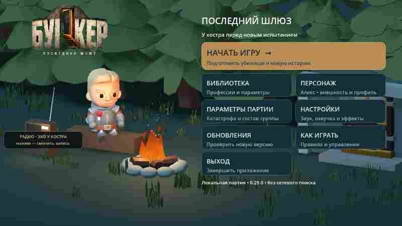
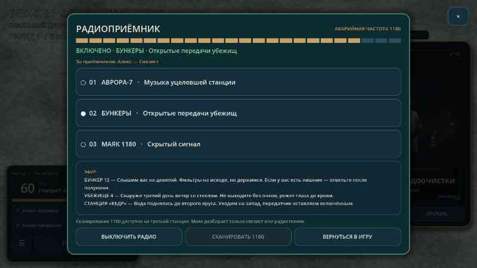
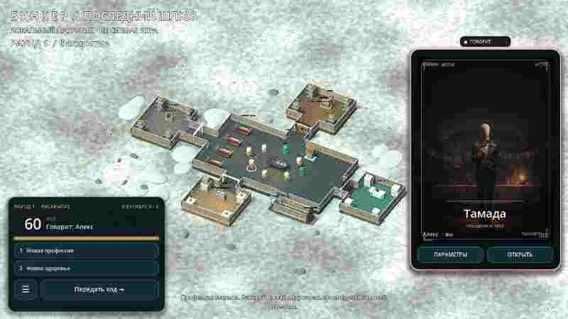
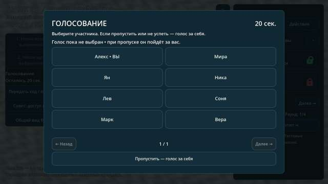
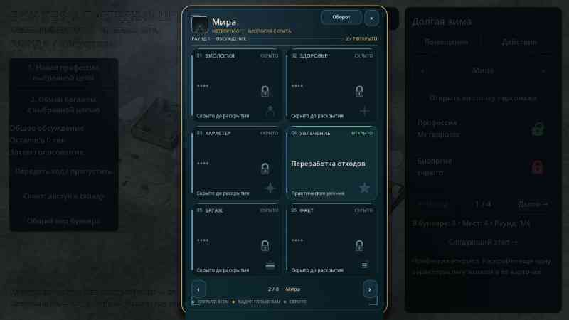
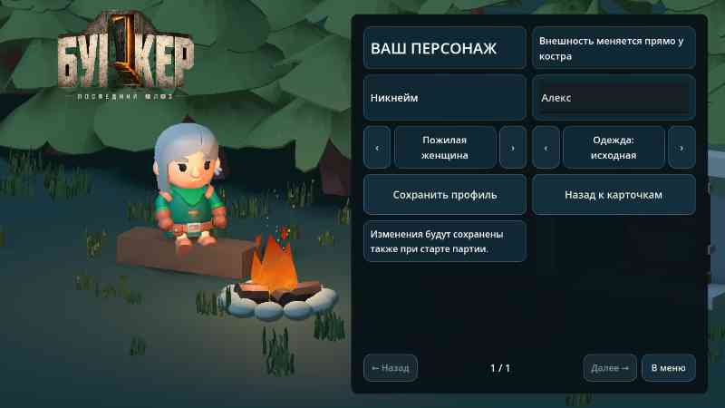
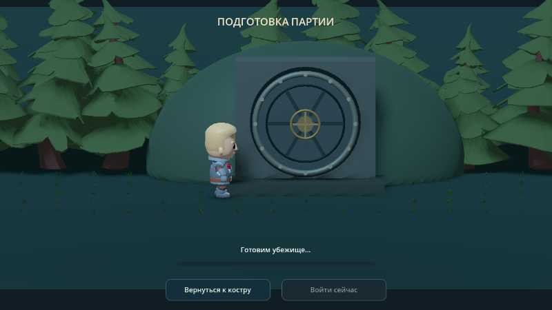
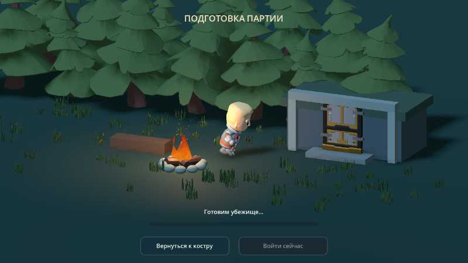

# Bunker

Проект игры «Бункер». Добавлен исходный локальный 3D-прототип Godot: комната, персонажи, раскрытие карточек и тестовое исключение. Проверки Godot и первая Android-сборка успешно выполнены в GitHub Actions; тест на физическом телефоне ещё предстоит.

**Запуск:** импортировать `project.godot` в Godot 4.5.1 и нажать F5. [Инструкция и ограничения](docs/RUNNING.md). [Подсчёт голосов, тесты и подготовка Android APK](docs/BUILD_STATUS.md).

**Сервер лобби развёрнут:** [alfagideon.blitz.cloud](https://alfagideon.blitz.cloud). В игре адрес уже стоит по умолчанию (`wss://alfagideon.blitz.cloud/ws`); приглашения создаются тем же хостом. Как развернуть заново — [docs/BLITZ_DEPLOY.md](docs/BLITZ_DEPLOY.md).

- [Функциональные блоки приложения и правила MVP](FUNCTIONALITY.md)
- [Конкретные ресурсы, движок и порядок их использования](docs/RESOURCES.md)
- [Схема первой анимированной сцены и критерии готовности](docs/FIRST_SCENE.md)
- [Текущая библиотека характеристик и 40 профессий](data/content.json)

Направление прототипа: Godot 4, стилизованное 3D с камерой сверху под углом и карточным 2D-интерфейсом; целевая платформа — Android. Подключены 3D-модели Quaternius (CC0); источники и лицензии — в [THIRD_PARTY.md](THIRD_PARTY.md).

В партии справа лежит вертикальная игральная карта текущего говорящего: она подсвечивается, показывает сгенерированную портретную иллюстрацию обезличенного манекена в снаряжении профессии и по касанию переворачивается к шести параметрам, а «Открыть» разворачивает полное досье с замками. Касание любого выжившего просто меняет карту справа — списка участников и боковой панели больше нет. [Подробности](docs/ITERATION_27.md).

## 0.41: игра по ссылке в браузере

Ссылка-приглашение теперь открывается и на компьютере: страница `/invite/<комната>` предлагает **«Играть в браузере»**, и браузерная сборка входит в ту же комнату, что и телефоны. Сервер лобби отдаёт сборку по адресу `/play`, скачивая её из релиза `web-<версия>`. Адрес сервера браузер берёт из адреса страницы, поэтому приглашение работает на любом развёртывании без пересборки. [Подробности](docs/ITERATION_41.md).

## APK — 0.40: лобби работает на blitz.cloud

[**Скачать APK 0.40**](https://github.com/AlfaGideon/Bunker/releases/download/android-40/Bunker-Posledniy-Shlyuz-40.apk) · [Release](https://github.com/AlfaGideon/Bunker/releases/tag/android-40) · [Подробности](docs/ITERATION_40.md)

Сервер лобби развёрнут: [alfagideon.blitz.cloud](https://alfagideon.blitz.cloud), `/healthz` отвечает `ok`. В игре адрес `wss://alfagideon.blitz.cloud/ws` уже стоит по умолчанию, поэтому «Создать лобби» и «Найти лобби» соединяются без ручного ввода, а ссылка-приглашение ведёт на тот же хост. Клиент сначала открывает WebSocket и, если какой-то хостинг его не пропускает, сам переходит на тот же протокол через HTTPS-опрос — это работает и для серверов из приглашений. Живой тест в GitHub Actions подтвердил на развёрнутом сервере создание комнаты, ботов, приглашение и запуск партии только ведущим.

Ещё в сборке: вид от первого лица при входе в игру, лобби с ботами, страница приглашения с потоковой выдачей APK (`/download`). Синхронизация ходов между участниками пока не сделана.

## APK — 0.29: музыка у костра и в бункере

[**Скачать APK 0.29**](https://github.com/AlfaGideon/Bunker/releases/download/android-29/Bunker-Posledniy-Shlyuz-29.apk) · [Release](https://github.com/AlfaGideon/Bunker/releases/tag/android-29) · [Подробности](docs/ITERATION_29.md)

У костра в главном меню появился настоящий приёмник: касание переключает запись, и в нём нет ничего, кроме музыки. Четыре оригинальные пьесы — «Эхо у костра» (гитара, ветер, огонь), «Зона» (медленные пэды), «Гудок» (гул бункера и металл) и «Последний шлюз» (пиано и винил) — написаны генератором `tools/generate_music.py`, без чужих сэмплов и лицензий. В партии та же музыка живёт на станции «АВРОРА-7», а приёмник теперь слышно из любой точки бункера.

Приёмник в бункере теперь карточка с тремя пунктами. «АВРОРА-7» играет настоящую музыку — 31,75-секундную авторскую петлю тёмного эмбиента. «БУНКЕРЫ» ловят передачи других убежищ: они приходят в эфир сами, звучат приглушённым голосом и попадают в журнал партии и в ленту приёмника. «МАЯК 1180» — скрытый сигнал, который разбирает только Связист или Радиотехник: одна передача за раунд, тайник или предупреждение. Слушать музыку и открытый эфир может любой участник.

Боковое меню в партии убрано полностью. Справа — одна карта персонажа: по умолчанию это карта того, кто говорит сейчас, она светится и подписана «ГОВОРИТ». Касание любого выжившего просто меняет карту, касание карты переворачивает её к шести параметрам, «Открыть» разворачивает полное досье. В левом нижнем углу — компактная панель хода с раундом, таймером, двумя способностями, кнопкой действия и единственной кнопкой «☰» с меню партии.

После всех речей — **60 секунд обсуждения**, затем в центре появляется голосование на **20 секунд**. Пропуск или истечение времени означает **голос за себя**. При ничьей проводится повторное голосование. Остальные участники пока локальные тестовые персонажи; сетевой игры нет. Проверены таймеры, собственное исключение, повторное голосование и поле на десять участников. Физическая проверка на BL9000 ещё нужна.

## APK — 0.28: живое радио

[**Скачать APK 0.28**](https://github.com/AlfaGideon/Bunker/releases/download/android-28/Bunker-Posledniy-Shlyuz-28.apk) · [Release](https://github.com/AlfaGideon/Bunker/releases/tag/android-28) · [Подробности](docs/ITERATION_28.md)

Приёмник в бункере стал карточкой с тремя пунктами: музыка, передачи других убежищ и маяк 1180, который разбирает только Связист или Радиотехник.

## APK — 0.27: карта говорящего вместо бокового меню

[**Скачать APK 0.27**](https://github.com/AlfaGideon/Bunker/releases/download/android-27/Bunker-Posledniy-Shlyuz-27.apk) · [Release](https://github.com/AlfaGideon/Bunker/releases/tag/android-27) · [Подробности](docs/ITERATION_27.md)

Боковое меню в партии убрано полностью: справа одна карта персонажа, по умолчанию карта говорящего с подсветкой, в левом нижнем углу компактная панель хода и единственная кнопка «☰».

## APK — 0.26: карточки персонажей и библиотека профессий

[**Скачать APK 0.26**](https://github.com/AlfaGideon/Bunker/releases/download/android-26/Bunker-Posledniy-Shlyuz-26.apk) · [Release](https://github.com/AlfaGideon/Bunker/releases/tag/android-26) · [Подробности](docs/ITERATION_26.md)

Вертикальная карточка персонажа с переворотом, 67 профессий с индивидуальными портретами и библиотека из двух разделов: каталог профессий с фильтром групп и редактор параметров.

## APK — 0.19: выбор фигурки персонажа

[**Скачать APK 0.19**](https://github.com/AlfaGideon/Bunker/releases/download/android-19/Bunker-Posledniy-Shlyuz-19.apk) · [Release](https://github.com/AlfaGideon/Bunker/releases/tag/android-19) · [Подробнее](docs/ITERATION_19.md)

В разделе «Персонаж» стрелками выберите одну из шести фигурок: две прежние и четыре дополнительные — молодой или пожилой мужчина и женщина. Внешность сразу видна у костра, сохраняется в профиле и используется в партии и кат-сцене. Возраст и пол из раскрытой биологии имеют приоритет. KayKit Mage и Barbarian — новые модели; женские варианты основаны на уже включённых моделях Rogue и Rogue Hooded, первый адаптирован с седыми волосами. Проверены все варианты и их походка; установка и производительность на BL9000 пока не проверены.

## Предыдущий APK — 0.18: боковая кат-сцена

[**Скачать APK 0.18**](https://github.com/AlfaGideon/Bunker/releases/download/android-18/Bunker-Posledniy-Shlyuz-18.apk) · [Release](https://github.com/AlfaGideon/Bunker/releases/tag/android-18) · [Подробности](docs/ITERATION_18.md)

Герой встаёт у костра и бежит вправо. Камера следует за ним, костёр и лес уходят влево; справа появляется отдельная **круглая дверь** убежища. Проверены реальные кадры и перемещения в экранных координатах. Подпись совпадает с 0.17. Реальная установка и производительность на BL9000 требуют проверки.

## Предыдущий APK — 0.17: от костра к бункеру

[**Скачать APK 0.17**](https://github.com/AlfaGideon/Bunker/releases/download/android-17/Bunker-Posledniy-Shlyuz-17.apk) · [Release](https://github.com/AlfaGideon/Bunker/releases/tag/android-17) · [Подробнее](docs/ITERATION_17.md)

Персонаж встаёт с места у костра, боковое меню плавно уезжает, и он бежит по траве к двери бункера в том же лесном лагере. Костёр и деревья остаются на месте; камера показывает путь и прибытие. Пунктирная дорожка и циклический бег удалены. Сохранены настоящая загрузка ресурсов, отмена, пропуск и уменьшение движения. Рендеры пути и прибытия просмотрены, проверки Godot и Android прошли. Подпись совпадает с 0.16; установка и производительность на BL9000 ещё не проверены.

## Предыдущий APK — 0.16: исправленный экран обновлений

[**Скачать APK 0.16**](https://github.com/AlfaGideon/Bunker/releases/download/android-16/Bunker-Posledniy-Shlyuz-16.apk) · [Release](https://github.com/AlfaGideon/Bunker/releases/tag/android-16) · [Подробнее](docs/ITERATION_16.md)

Обновлён экран проверки: вместо серого диалога — анимированная карточка с текущей и последней сборкой и горизонтальными кнопками. Основная проверка работает через публичный адрес GitHub, не используя лимитируемый API; есть запасной запрос и повторная попытка. Реальный запрос к GitHub прошёл в CI. Сертификат совпадает с 0.15; установка на физическом BL9000 пока не проверена. Если старая версия показывает 403, скачайте APK по ссылке выше и подтвердите обновление вручную.

## Предыдущий APK — 0.15: карточки везде и замки характеристик

[**Скачать APK**](https://github.com/AlfaGideon/Bunker/releases/download/android-15/Bunker-Posledniy-Shlyuz-15.apk) · [Release](https://github.com/AlfaGideon/Bunker/releases/tag/android-15) · [Подпись и совместимость](https://github.com/AlfaGideon/Bunker/actions/runs/40704103210) · [Godot CI](https://github.com/AlfaGideon/Bunker/actions/runs/40704103644)

**Все меню — карточные и без вертикальной прокрутки:** подразделы приветствия, меню партии, профиль, настройки, помещения, совет, отрицательные действия, досье и выживание. Страницы переключаются кнопками «Назад / Далее», состояние полей и выбранных чисел сохраняется. Вместо выпадающих списков — сенсорные кнопки выбора; ползунок оставлен только для громкости. Масштаб камеры — «Ближе / Дальше», прямые жесты сохранены.

У каждой характеристики **маленький красный закрытый замок**; после раскрытия — **зелёный открытый**. Значение становится публичным в локальном досье. Раскрытие не сбрасывает и не продлевает речь: остаётся то же время. Сохранены свой ход, одна дополнительная карта за ход и публичная с начала профессия.

Приложение по-прежнему называется **«Бункер — Последний шлюз»**. Лагерь, семь главных карточек и настоящая Running_A на заставке подготовки сохранены. Сертификат подписи сравнен и совпал с 0.14, package ID прежний. В Release есть идентичный `bunker-15.apk` для совместимости с обновлением клиента 0.13.

[**Подробности 0.15**](docs/ITERATION_15.md) · [Обновления и подпись](docs/ANDROID_UPDATES.md).

Исходники `d5e8448`; version code **15**, версия **0.15.0**, APK **59 876 268 байт**. Все 15 GDScript-тестов, Python-проверка версии, четыре job Godot, Android export и подписанный Release успешны. Проверены реальные рендеры карточек, замков и d20; единый набор из 16 JPEG обновлён без накопления версий. Физическая установка 14 → 15, касания и FPS на BL9000 ещё требуют проверки.

**В самой партии сохранены:** отдельные наружные пристройки и коридоры, профессиональный доступ, совет склада, кухня/еда, две способности, выступления по 60 секунд, выбор d6/d20. Камера управляется свайпом и двумя пальцами, на ПК — мышью и колесом.

**Локальный прототип, не онлайн-игра.** Остальные участники — тестовые фикстуры. Нет чата/микрофона и сохранения партии между запусками. Проверка на физическом BL9000 ещё нужна. При конфликте debug-подписи потребуется удалить прежнюю установку с потерей профиля. [Источники моделей и лицензии](THIRD_PARTY.md).

Предыдущие итерации: [0.14](docs/ITERATION_14.md), [0.13](docs/ITERATION_13.md), [0.12](docs/ITERATION_12.md), [0.11](docs/ITERATION_11.md), [0.10](docs/ITERATION_10.md), [0.9](docs/ITERATION_09.md), [0.8](docs/ITERATION_08.md), [0.7](docs/ITERATION_07.md), [0.6](docs/ITERATION_06.md).
