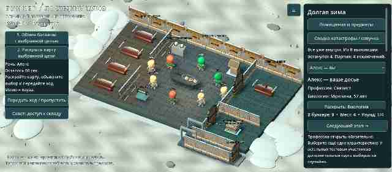
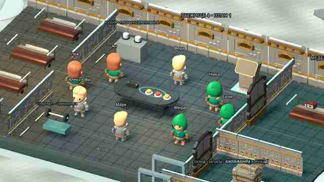
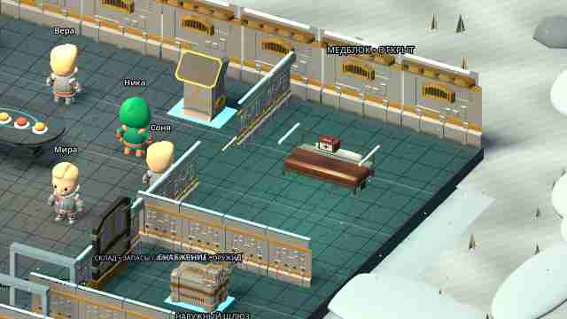
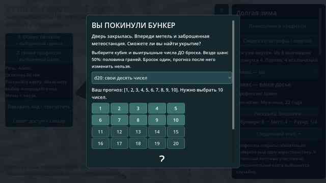

# Bunker

Проект игры «Бункер». Добавлен исходный локальный 3D-прототип Godot: комната, персонажи, раскрытие карточек и тестовое исключение. Проверки Godot и первая Android-сборка успешно выполнены в GitHub Actions; тест на физическом телефоне ещё предстоит.

**Запуск:** импортировать `project.godot` в Godot 4.5.1 и нажать F5. [Инструкция и ограничения](docs/RUNNING.md). [Подсчёт голосов, тесты и подготовка Android APK](docs/BUILD_STATUS.md).

- [Функциональные блоки приложения и правила MVP](FUNCTIONALITY.md)
- [Конкретные ресурсы, движок и порядок их использования](docs/RESOURCES.md)
- [Схема первой анимированной сцены и критерии готовности](docs/FIRST_SCENE.md)
- [Текущая библиотека характеристик и 40 профессий](data/content.json)

Направление прототипа: Godot 4, стилизованное 3D с камерой сверху под углом и карточным 2D-интерфейсом; целевая платформа — Android. Подключены 3D-модели Quaternius (CC0); источники и лицензии — в [THIRD_PARTY.md](THIRD_PARTY.md).

## Текущий тестовый APK — 0.7

[**Скачать ZIP с bunker-debug.apk**](https://github.com/AlfaGideon/Bunker/actions/runs/40626347269/artifacts/12788754491) (нужен вход в GitHub; хранение 14 дней).

Профессиональный доступ к работе и поручения подходящим участникам, кухня и еда за столом, две одноразовые способности слева, выступления по 60 секунд с пропуском и автопереходом. Отдельный совет решает открытие склада; он может остаться опечатанным до конца. Количество коек равно вместимости, медблок постоянный и без чёрной плиты, дополнительная рабочая зона меняется между партиями. Металлический выходной коридор с открывающимся шлюзом; снаружи — грунт, растительность, камни и погодные эффекты. После изгнания вы выбираете d6/d20 и выигрышные числа до единственного броска.

[**Изменения и как проверить**](docs/ITERATION_07.md) · [Запуск](docs/RUNNING.md) · [Проверки и установка APK](docs/BUILD_STATUS.md) · [Godot CI](https://github.com/AlfaGideon/Bunker/actions/runs/40626347283).

Исходники APK: `8782260`; ZIP 61 196 910 байт. Сохранены 12 катастроф, общие последствия здоровья, усталость, лицензированные CC0-модели и исправленная походка. [Источники и лицензии](THIRD_PARTY.md).

**Это локальный прототип, не онлайн-игра.** Остальные участники — управляемые тестовые фикстуры, не интеллектуальные боты. Нет чата/микрофона и сохранения партии. Это стилизованная мобильная графика, не фотореализм. Касания, FPS и звук на физическом BL9000 ещё не проверены. При конфликте debug-подписи потребуется удалить прежнюю установку с потерей локального профиля.

Предыдущие итерации: [0.6](docs/ITERATION_06.md), [0.5](docs/ITERATION_05.md), [0.4](docs/ITERATION_04.md).
