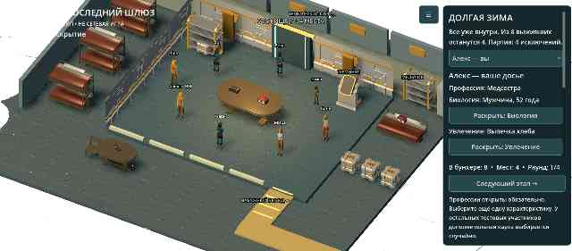
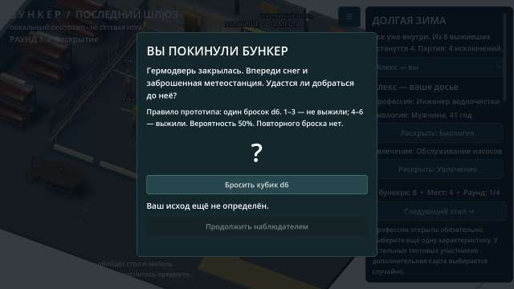

# Bunker

Проект игры «Бункер». Добавлен исходный локальный 3D-прототип Godot: комната, персонажи, раскрытие карточек и тестовое исключение. Проверки Godot и первая Android-сборка успешно выполнены в GitHub Actions; тест на физическом телефоне ещё предстоит.

**Запуск:** импортировать `project.godot` в Godot 4.5.1 и нажать F5. [Инструкция и ограничения](docs/RUNNING.md). [Подсчёт голосов, тесты и подготовка Android APK](docs/BUILD_STATUS.md).

- [Функциональные блоки приложения и правила MVP](FUNCTIONALITY.md)
- [Конкретные ресурсы, движок и порядок их использования](docs/RESOURCES.md)
- [Схема первой анимированной сцены и критерии готовности](docs/FIRST_SCENE.md)
- [Текущая библиотека характеристик и 40 профессий](data/content.json)

Направление прототипа: Godot 4, стилизованное 3D с камерой сверху под углом и карточным 2D-интерфейсом; целевая платформа — Android. Подключены 3D-модели Quaternius (CC0); источники и лицензии — в [THIRD_PARTY.md](THIRD_PARTY.md).

## Текущий тестовый APK — 0.4

[Скачать ZIP с bunker-debug.apk](https://github.com/AlfaGideon/Bunker/actions/runs/40615714424/artifacts/12783794729) (нужен вход в GitHub; артефакт хранится 14 дней).

Полноэкранный Android с расширением под пропорции экрана, компактная кнопка меню, исправленный продольный шаг на мужских и женских моделях. Профессия открыта обязательно, остальные карты у тестовых участников выбираются случайно. Биология содержит пол и возраст; её раскрытие меняет модель. В настройках — предпочтение внешности до раскрытия. Снаружи — снег; из меню можно протестировать своё изгнание и однократный d6 с эпилогом.

[Изменения, инструкция и проверенные ограничения](docs/ITERATION_04.md). На физическом Blackview BL9000 эта сборка ещё не проверена. При отказе обновления удалить старый прототип из-за смены debug-подписи; локальный профиль при удалении теряется.

