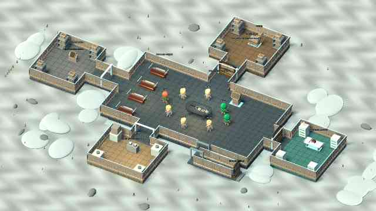
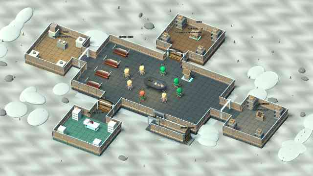
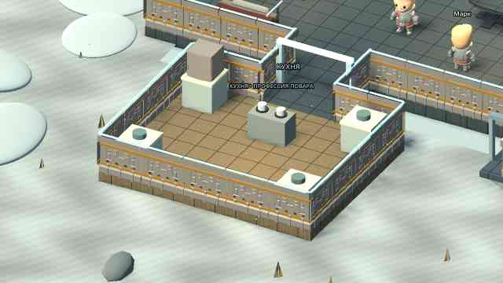
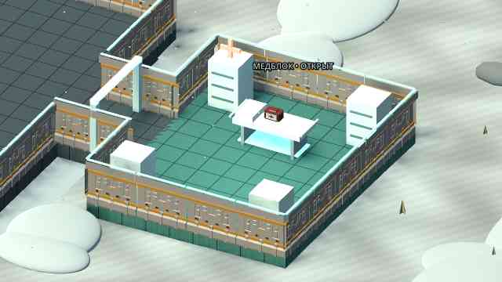

# Bunker

Проект игры «Бункер». Добавлен исходный локальный 3D-прототип Godot: комната, персонажи, раскрытие карточек и тестовое исключение. Проверки Godot и первая Android-сборка успешно выполнены в GitHub Actions; тест на физическом телефоне ещё предстоит.

**Запуск:** импортировать `project.godot` в Godot 4.5.1 и нажать F5. [Инструкция и ограничения](docs/RUNNING.md). [Подсчёт голосов, тесты и подготовка Android APK](docs/BUILD_STATUS.md).

- [Функциональные блоки приложения и правила MVP](FUNCTIONALITY.md)
- [Конкретные ресурсы, движок и порядок их использования](docs/RESOURCES.md)
- [Схема первой анимированной сцены и критерии готовности](docs/FIRST_SCENE.md)
- [Текущая библиотека характеристик и 40 профессий](data/content.json)

Направление прототипа: Godot 4, стилизованное 3D с камерой сверху под углом и карточным 2D-интерфейсом; целевая платформа — Android. Подключены 3D-модели Quaternius (CC0); источники и лицензии — в [THIRD_PARTY.md](THIRD_PARTY.md).

## Текущий тестовый APK — 0.9: камера жестами

[**Скачать ZIP с bunker-debug.apk**](https://github.com/AlfaGideon/Bunker/actions/runs/40630031665/artifacts/12790214797) (нужен вход в GitHub; хранение 14 дней).

**Камера без настроек:** свайп одним пальцем перемещает вид; два пальца приближают/отдаляют и перемещают его. Касание без свайпа отправляет персонажа к точке. Кнопки и прокрутка панелей не двигают камеру. На ПК — перетаскивание мышью и колесо. [Управление и проверки 0.9](docs/ITERATION_09.md).

**Теперь меняется само здание, а не только мебель внутри прямоугольника.** В основном зале остаются стол и спальня. Кухня, медотсек и склад — отдельные наружные модули со своими полами, стенами, дверями и соединительными коридорами. Они меняются сторонами; меняется длина соединений. Спортзал / мастерская / теплица тоже появляются как самостоятельные пристройки. Комнаты оснащены несколькими предметами по назначению.

Кнопки «Осмотреть» приближают отдельные комнаты; слева есть возврат к общему виду. Права профессий, совет склада, кухня/еда, две способности, выступления по 60 секунд и выбор d6/d20 сохранены.

[**Изменения архитектуры и управление**](docs/ITERATION_08.md) · [Правила предыдущей 0.7](docs/ITERATION_07.md) · [Godot CI](https://github.com/AlfaGideon/Bunker/actions/runs/40630031568) · [Android build](https://github.com/AlfaGideon/Bunker/actions/runs/40630031665).

Исходники APK: `ccc3343`; version code 9, ZIP **61 209 806 байт**. Проверки 60 seed включают расположение комнат снаружи зала, соединения, маршруты, отсутствие пересечений и смену сторон всех обязательных пристроек.

**Локальный прототип, не онлайн-игра.** Остальные участники — управляемые тестовые фикстуры. Нет чата/микрофона и сохранения партии. Стилизованная графика, не фотореализм. Касания, FPS и звук на физическом BL9000 ещё не проверены. При конфликте debug-подписи потребуется удалить прежнюю установку с потерей профиля. [Источники моделей и лицензии](THIRD_PARTY.md).

Предыдущие итерации: [0.8](docs/ITERATION_08.md), [0.7](docs/ITERATION_07.md), [0.6](docs/ITERATION_06.md), [0.5](docs/ITERATION_05.md), [0.4](docs/ITERATION_04.md).
