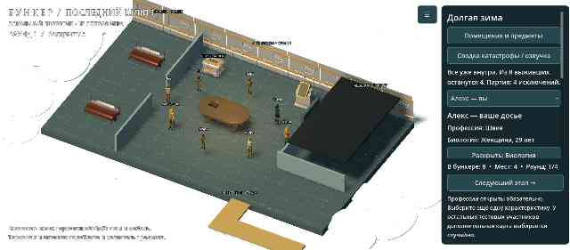
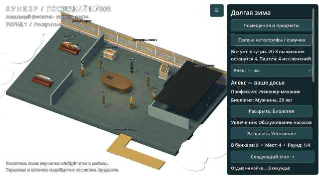
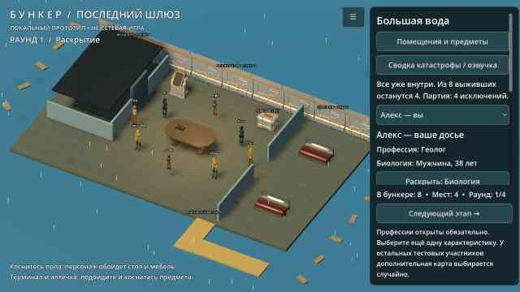

# Bunker

Проект игры «Бункер». Добавлен исходный локальный 3D-прототип Godot: комната, персонажи, раскрытие карточек и тестовое исключение. Проверки Godot и первая Android-сборка успешно выполнены в GitHub Actions; тест на физическом телефоне ещё предстоит.

**Запуск:** импортировать `project.godot` в Godot 4.5.1 и нажать F5. [Инструкция и ограничения](docs/RUNNING.md). [Подсчёт голосов, тесты и подготовка Android APK](docs/BUILD_STATUS.md).

- [Функциональные блоки приложения и правила MVP](FUNCTIONALITY.md)
- [Конкретные ресурсы, движок и порядок их использования](docs/RESOURCES.md)
- [Схема первой анимированной сцены и критерии готовности](docs/FIRST_SCENE.md)
- [Текущая библиотека характеристик и 40 профессий](data/content.json)

Направление прототипа: Godot 4, стилизованное 3D с камерой сверху под углом и карточным 2D-интерфейсом; целевая платформа — Android. Подключены 3D-модели Quaternius (CC0); источники и лицензии — в [THIRD_PARTY.md](THIRD_PARTY.md).

## Текущий тестовый APK — 0.5

[Скачать ZIP с bunker-debug.apk](https://github.com/AlfaGideon/Bunker/actions/runs/40618646261/artifacts/12785504893) (нужен вход в GitHub; артефакт хранится 14 дней).

Единый проходимый бункер вместо комнаты внутри декораций; три seed-планировки с перестановкой мебели. На койках можно спать; склад и терминал восстанавливают систему, после первого раунда открывается отдельный тёмный медблок с ограниченным запасом обследований. Есть локальное радио, звуки и вступительная сводка через системный русский голос, если он установлен. На выбор — зима, наводнение, метеорный дождь и заражение: разные окружения, описания и эпилоги. Полноэкранный режим, биология и собственное изгнание из 0.4 сохранены.

[Изменения, порядок проверки и ограничения 0.5](docs/ITERATION_05.md). [Успешные проверки и девять реальных рендеров](https://github.com/AlfaGideon/Bunker/actions/runs/40618646278); [успешный Android export](https://github.com/AlfaGideon/Bunker/actions/runs/40618646261). Исходники APK: `ba9b3ac`.

На физическом Blackview BL9000 эта сборка ещё не проверена. Озвучка зависит от системного синтезатора и установленного русского голоса. При отказе обновления удалить старый прототип из-за смены debug-подписи; локальный профиль при удалении теряется. Остальные участники всё ещё тестовые, сетевой игры и боевого ИИ заражённых нет.

Предыдущая итерация: [0.4](docs/ITERATION_04.md).
