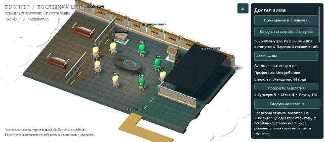
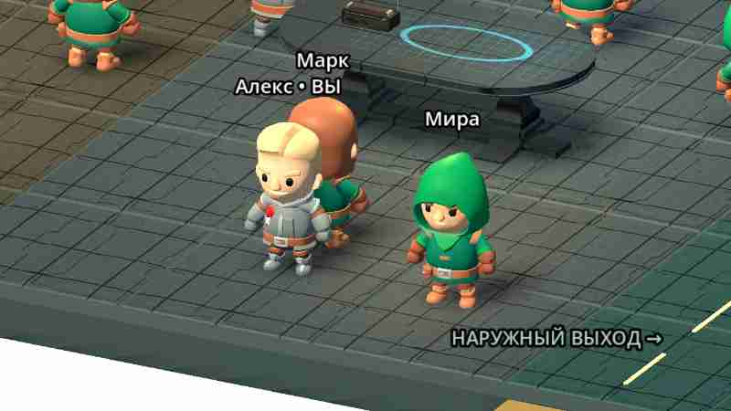
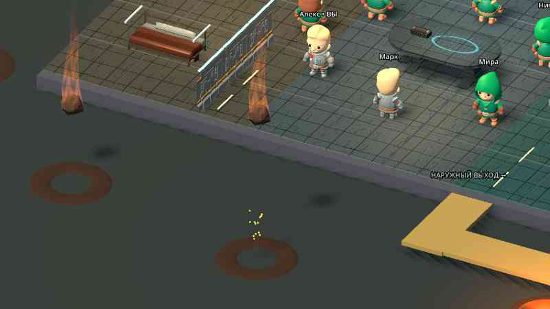

# Bunker

Проект игры «Бункер». Добавлен исходный локальный 3D-прототип Godot: комната, персонажи, раскрытие карточек и тестовое исключение. Проверки Godot и первая Android-сборка успешно выполнены в GitHub Actions; тест на физическом телефоне ещё предстоит.

**Запуск:** импортировать `project.godot` в Godot 4.5.1 и нажать F5. [Инструкция и ограничения](docs/RUNNING.md). [Подсчёт голосов, тесты и подготовка Android APK](docs/BUILD_STATUS.md).

- [Функциональные блоки приложения и правила MVP](FUNCTIONALITY.md)
- [Конкретные ресурсы, движок и порядок их использования](docs/RESOURCES.md)
- [Схема первой анимированной сцены и критерии готовности](docs/FIRST_SCENE.md)
- [Текущая библиотека характеристик и 40 профессий](data/content.json)

Направление прототипа: Godot 4, стилизованное 3D с камерой сверху под углом и карточным 2D-интерфейсом; целевая платформа — Android. Подключены 3D-модели Quaternius (CC0); источники и лицензии — в [THIRD_PARTY.md](THIRD_PARTY.md).

## Текущий тестовый APK — 0.6

[Скачать ZIP с bunker-debug.apk](https://github.com/AlfaGideon/Bunker/actions/runs/40622500528/artifacts/12787931996) (нужен вход в GitHub; артефакт хранится 14 дней).

Панельные стены, металлический пол, вентиляция, трубы, локальное освещение и командный стол. Подключены другие CC0-фигуры KayKit с авторской походкой и противофазой рук и ног. Метеориты — неровные каменные меши с турбулентным огненным следом, искрами и ударной вспышкой. Катастроф теперь 12. Отрицательные состояния здоровья расходуют общие запасы; дефицит ухудшает восстановление, усиливает усталость и замедляет ходьбу.

[Подробные изменения, источники и ограничения](docs/ITERATION_06.md). [Успешные проверки и рендеры](https://github.com/AlfaGideon/Bunker/actions/runs/40622500486). Исходники APK: `498d586`; ZIP 61 170 539 байт.

Это стилизованная мобильная графика, не фотореализм. Касания и FPS на физическом BL9000 ещё не проверены. При конфликте debug-подписи потребуется удалить прежнюю установку с потерей локального профиля. Сетевая игра и полноценные боты не добавлены.

Предыдущие итерации: [0.5](docs/ITERATION_05.md), [0.4](docs/ITERATION_04.md).
