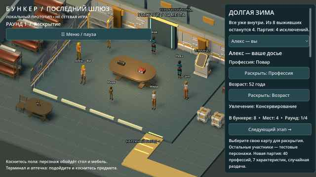
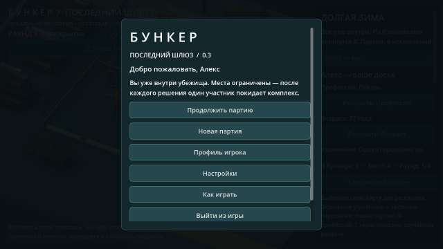

# Bunker

Проект игры «Бункер». Добавлен исходный локальный 3D-прототип Godot: комната, персонажи, раскрытие карточек и тестовое исключение. Проверки Godot и первая Android-сборка успешно выполнены в GitHub Actions; тест на физическом телефоне ещё предстоит.

**Запуск:** импортировать `project.godot` в Godot 4.5.1 и нажать F5. [Инструкция и ограничения](docs/RUNNING.md). [Подсчёт голосов, тесты и подготовка Android APK](docs/BUILD_STATUS.md).

- [Функциональные блоки приложения и правила MVP](FUNCTIONALITY.md)
- [Конкретные ресурсы, движок и порядок их использования](docs/RESOURCES.md)
- [Схема первой анимированной сцены и критерии готовности](docs/FIRST_SCENE.md)
- [Текущая библиотека характеристик и 40 профессий](data/content.json)

Направление прототипа: Godot 4, стилизованное 3D с камерой сверху под углом и карточным 2D-интерфейсом; целевая платформа — Android. Подключены 3D-модели Quaternius (CC0); источники и лицензии — в [THIRD_PARTY.md](THIRD_PARTY.md).

## Текущий тестовый APK — 0.3

[Скачать ZIP с bunker-debug.apk](https://github.com/AlfaGideon/Bunker/actions/runs/40613265719/artifacts/12783806544) (нужен вход в GitHub; артефакт хранится 14 дней).

Внутри бункера: оформленные соседние отсеки, главное меню, локальный профиль и сохраняемые настройки, 6/8/10 участников, 40 профессий и 7 характеристик. Исправлены исходные повороты костей; исключённые участники идут к выходу. Нет сети и сохранения текущей партии. При отказе обновления удалить старый APK из-за смены debug-подписи (профиль при удалении теряется).

[Что изменилось и что проверено](docs/ITERATION_03.md).

