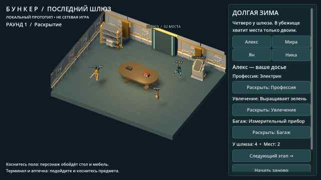

# Bunker

Проект игры «Бункер». Добавлен исходный локальный 3D-прототип Godot: комната, персонажи, раскрытие карточек и тестовое исключение. Проверки Godot и первая Android-сборка успешно выполнены в GitHub Actions; тест на физическом телефоне ещё предстоит.

**Запуск:** импортировать `project.godot` в Godot 4.5.1 и нажать F5. [Инструкция и ограничения](docs/RUNNING.md). [Подсчёт голосов, тесты и подготовка Android APK](docs/BUILD_STATUS.md).

- [Функциональные блоки приложения и правила MVP](FUNCTIONALITY.md)
- [Конкретные ресурсы, движок и порядок их использования](docs/RESOURCES.md)
- [Схема первой анимированной сцены и критерии готовности](docs/FIRST_SCENE.md)
- [Начальные данные локального прототипа: 4 персонажа и сценарий](data/prototype.json)

Направление прототипа: Godot 4, стилизованное 3D с камерой сверху под углом и карточным 2D-интерфейсом; целевая платформа — Android. Подключены 3D-модели Quaternius (CC0); источники и лицензии — в [THIRD_PARTY.md](THIRD_PARTY.md).

## Текущий тестовый APK — 0.2

[Скачать ZIP с bunker-debug.apk](https://github.com/AlfaGideon/Bunker/actions/runs/40611927187/artifacts/12782708530) (нужен вход в GitHub; артефакт хранится 14 дней).

В этой версии: импортированные модели персонажей и мебели, процедурная скелетная анимация, обход стола по комнате, осмотр терминала и аптечки. Это локальный прототип без сетевой игры. Перед установкой может потребоваться удаление предыдущего APK из-за смены debug-подписи.

[Что изменилось и как проверить](docs/ITERATION_02.md).

