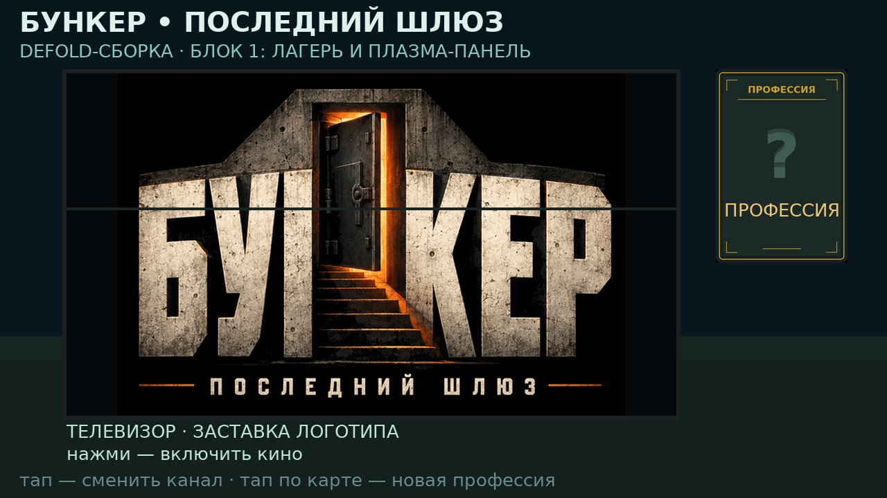

# Порт на Defold: план по блокам

Отдельная сборка на движке **Defold** живёт рядом с Godot-версией: свой проект в
`defold/`, свой workflow и свой тег релиза `defold-N`. Пакет —
`org.bunker.defold`, поэтому Defold-APK ставится рядом с основной игрой и ничего
не затирает. Нумерация основной игры (`android-NN`, `web-NN`) не затрагивается.

Текущая сборка: [defold-2](https://github.com/AlfaGideon/Bunker/releases/tag/defold-2) —
[`Bunker-Defold-2.apk`](https://github.com/AlfaGideon/Bunker/releases/download/defold-2/Bunker-Defold-2.apk),
пакет `org.bunker.defold`, versionCode 2, versionName 0.51.2, minSdk 21, та же
подпись «CN=Bunker Android Release», ставится рядом с основной игрой.

Первая сборка (`defold-1`, versionCode 1) запускалась, но на телефоне оказалась
статичной кривой картинкой без отклика на касания: ошибки разобраны и исправлены
в [defold-2](#сборка-2-почему-первый-apk-был-статичной-картинкой).

## Зачем отдельная сборка

- Проверить, как игра выглядит и ощущается на другом движке, не ломая рабочую
  Godot-версию.
- Defold даёт маленький рантайм, быстрый старт и простой Android-пайплайн
  (`bob.jar` + Android SDK), что важно для слабых телефонов.
- Общий источник правды — `data/content.json`: он экспортируется в Lua
  (`tools/export_defold_data.py` → `defold/main/data/content.lua`), и CI падает,
  если экспорт разошёлся с JSON.

## Блоки

| № | Блок | Статус | Что считается готовым |
| - | --- | --- | --- |
| 1 | Лагерь и плазменная панель | **готово, `defold-2`** | сцена лагеря, панель с заставкой логотипа, аниме-канал со сменой кадров, рекламный блок, карточка профессии из общего JSON, сборка и подпись APK в CI |
| 2 | Колода 70 профессий | в работе | все 70 портретов и пиктограмм, раздача карточек, переворот карты к параметрам, библиотека профессий |
| 3 | Партия: раунды и правила | — | раскрытие карточек, голосование, способности профессий, лог партии — паритет с `server/match_game.py` |
| 4 | Бункер: помещения и станции | — | зал, кинозал, кухня, медотсек, пристройки; взаимодействия и станции |
| 5 | Лобби по WebSocket | — | те же комнаты и протокол, что у Godot-клиента (`server/app.py`), приглашения и боты |
| 6 | Звук и музыка | — | те же треки и звуки, что в `assets/audio` |

Блоки 1–2 — 2D-интерфейс; 3D-сцена лагеря (Blender-модели через glTF) встаёт в
блок 4, когда появятся материалы и свет под Defold.

## Что уже есть в блоке 1

- `defold/game.project` — 1280×720, `org.bunker.defold`, version code 2
  (0.51.2), сборка `defold-2`.
- `defold/main/main.collection`, `camp.go`, `camp.gui`, `camp.gui_script`,
  `camp.script` — сцена лагеря: небо, земля, рама панели, панель, бегущая
  полоса-блик, заголовок, подпись канала, карточка профессии, строка подсказки
  и экран загрузки.
- `defold/main/camp.atlas` — кадры панели (логотип, две аниме-раскадровки,
  рекламный щит) и рубашка карты.
- `defold/main/fonts/` — DejaVu Sans (кириллица в `extra_characters`).
- `defold/main/data/content.lua` — сгенерированный экспорт общего контента.
- `tools/gen_camp_gui.py` — таблица раскладки и генератор `camp.gui`
  (`--check` в CI не даёт генератору и файлу разъехаться).
- `tools/preview_defold_layout.py` — рисует раскладку в PNG без движка,
  результат — `docs/previews/defold_camp_layout.png`.



## Сборка 2: почему первый APK был статичной картинкой

Первая сборка (`defold-1`) запускалась, но на телефоне выглядела так: чёрный
фон, полоса «земли» посреди экрана, панель и карточка обрезаны снизу, подписи
наложены друг на друга, касания ничего не меняют. Причин было две, и обе теперь
закрыты.

1. **Ось Y.** Узлы `.gui` были разложены так, как их рисует редактор: начало
   координат в левом верхнем углу, `y` вниз. На устройстве gui проецируется
   рендер-скриптом по умолчанию как
   `matrix4_orthographic(0, window_width, 0, window_height, near, far)`
   (см. `engine/engine/content/builtins/render/default.render_script` в
   `defold/defold`), то есть `y` считается **вверх от нижней кромки**. Каждый
   узел оказался отражён по вертикали: «небо» ушло под экран (отсюда чёрный
   фон), «земля» встала в середину, панель и карточка уехали за нижний край.
   Теперь `camp.gui` генерируется из обычной таблицы «сверху вниз» с
   `y_node = 720 − y_top` — таблица читается как готовый экран.
2. **Ввод.** Экран не реагировал на касания: `defold-1` полагался на
   `on_input` gui-скрипта и на действие `touch` из
   `input/game.input_binding`. Теперь на игровом объекте есть `camp.script`: он
   забирает input focus (`msg.post(".", "acquire_input_focus")`) и пересылает
   любое нажатие в gui как сообщение `tap`; `tap()` принимает **любое**
   нажатие, независимо от имени действия, так что экран отвечает даже при
   неверной привязке. Одно нажатие, пришедшее двумя путями, считается один раз.

Заодно:

- появился экран загрузки (логотип и подпись, плавно уходит через ~1.5 с) —
  первый кадр больше не чёрный, и анимация видна сразу;
- по панели бежит полоса-блик, панель «дышит» — картинка не статична даже без
  касаний;
- нижняя строка показывает счётчик тапов, номер канала и координаты последнего
  нажатия: это и обратная связь игроку, и диагностика для следующей сборки;
- тап по карте (правая колонка) выдаёт новую профессию, тап в любом другом
  месте переключает канал;
- каналов три: заставка-логотип, аниме-раскадровка (кадры сменяются сами) и
  пустой рекламный блок.

Что в сборке 2 **не** проверено: запуск на телефоне. В песочнице нет ни
Defold, ни эмулятора — проверены сборка, подпись, схемы ресурсов, логика
скриптов (headless-тест) и раскладка (PNG-превью). Фактический вид и отклик на
касания подтверждаются только установкой APK.

### Как проверить на телефоне

1. Установить `Bunker-Defold-2.apk` (пакет `org.bunker.defold`, ставится рядом
   с Godot-версией).
2. При запуске — экран загрузки «BUNKER», затем лагерь.
3. Коснуться экрана: счётчик «тапов: N» в нижней строке растёт, канал
   меняется, подпись под панелью тоже.
4. Коснуться карточки справа: под «?» появляется новая профессия.
5. Панель должна стоять по центру, карточка — справа, подписи не должны
   налезать друг на друга и ничего не должно уезжать за край.

Если счётчик тапов не растёт — значит нажатия не доходят до скриптов; если
растёт, а канал не меняется — проблема в отрисовке. Координаты в нижней строке
показывают, в каком пространстве движок присылает `action.x/action.y`.

## Проверка ресурсов без движка

`tools/check_defold_files.py` разбирает `.gui`, `.atlas`, `.go`, `.collection`,
`.font` и `.input_binding` теми же protobuf-схемами, которыми их проверяет
`bob.jar` (копия схем — в `defold/proto`). Первые итерации показали, зачем это
нужно: `bob` ругался на `Atlas.material` и на несуществующий `TYPE_TEXTURE`
только после полной сборки APK, а проверка находит такое за секунду.

```bash
python3 -m pip install grpcio-tools
python3 tools/check_defold_files.py
python3 tools/gen_camp_gui.py --check
python3 -m pip install lupa
python3 tools/test_defold_gui.py
python3 tools/preview_defold_layout.py      # docs/previews/defold_camp_layout.png
```

Проверка ссылок расширена после сборки 1: она падает, если `camp.gui_script`
обращается к узлу `gui.get_node("...")`, которого нет в `.gui`, или просит
flipbook, которого нет в атласе — ровно те ошибки, которые в рантайме дают
`attempt to index a nil value` и замерший первый кадр. `tools/test_defold_gui.py`
прогоняет `init/update/on_input/on_message` на Lua с заглушками gui (через
`lupa`): старт, уход заставки, счётчик тапов, смена каналов, выдача профессии,
дедупликация нажатий и 200 кадров аниме-канала.

## Конвейер сборки

`.github/workflows/defold-build.yml` срабатывает на изменения в `defold/**` и
`tools/export_defold_data.py`:

1. `tools/export_defold_data.py --check` — Lua-экспорт совпадает с `data/content.json`.
2. `tools/gen_camp_gui.py --check` — `camp.gui` совпадает с таблицей раскладки.
3. `tools/check_defold_files.py` — текстовые ресурсы проверены схемами Defold и
   ссылками (шрифт/атлас/прообраз зарегистрированы и существуют).
4. `tools/test_defold_gui.py` — headless-прогон логики `camp.gui_script`.
5. `bob.jar` 1.14.0 берётся из релиза `defold/defold` (нужен **JDK 25**: bob
   собран под class file version 69).
6. Сборка и бандлинг: `--archive` обязателен — бандлер 1.14 сначала собирает
   AAB, а из него через `bundletool` делает universal APK. `--keystore-pass` и
   `--key-pass` у bob — это **пути к файлам** с паролями, а не сами пароли.
7. APK проверяется `aapt2 dump badging` и `apksigner verify`, отчёт попадает в
   заметки релиза; APK и `SHA256SUMS` уходят в релиз, имя которого задаёт
`RELEASE` (`defold-2` сейчас).

Ключ подписи — тот же, что у Godot-сборки (секреты `BUNKER_KEYSTORE_*`).
Если секретов нет, workflow собирает debug-вариант, чтобы пайплайн не стоял.

## Как собрать

```bash
python3 tools/export_defold_data.py            # обновить Lua-экспорт
cd defold
java -jar bob.jar --platform armv7-android --architectures arm64-android,armv7-android \
  --variant debug --bundle-output build/bob resolve build bundle
```

В CI это делает `.github/workflows/defold-build.yml`: качает `bob.jar` по
`https://d.defold.com/stable/info.json`, собирает и подписывает APK ключом
проекта (если секретов нет — debug-подписью), затем обновляет релиз
`defold-2`.

## Ограничения текущего блока

- Лагерь нарисован 2D-примитивами: 3D-сцена и модели из Blender — в блоке 4.
- Костёр из `defold-1` убран: он был прямоугольником под панелью и только
  мешал раскладке; огонь вернётся спрайтом вместе с 3D-сценой.
- Панель локальная: канал переключает сам игрок, лобби и «ведущий» появятся в
  блоке 5.
- Карточка показывает профессию без портрета — портреты в блоке 2.
- Рантайм проверен сборкой, подписью, схемами ресурсов, headless-тестом логики
  и превью раскладки; запуск на телефоне нужно подтвердить вручную,
  автоматического запуска APK в CI нет.
- Текст на экране рисуется DejaVu Sans (кириллица в `extra_characters`), а не
  шрифтом Godot-версии: шрифты пока не общие.
