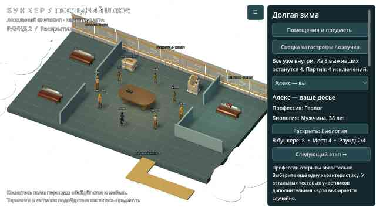
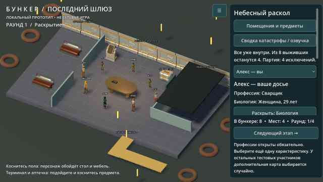
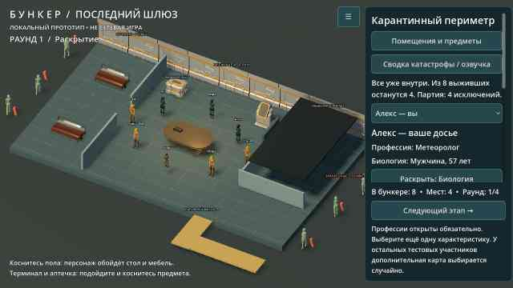

# Итерация 0.5 — обитаемый бункер

## Что изменилось

- **Единое убежище:** один пол 18 × 10,6 м, общая зона, спальня с проходом и отдельный закрытый медблок. Старой центральной комнаты внутри декоративного окружения больше нет. Видимые перегородки и маршруты строятся из одного описания планировки.
- **Новая расстановка:** три варианта, зеркальное расположение отсеков, разные палитры, перестановка склада и терминала, смещение стола и выбор коек. Без заданного seed соседние старты не повторяют вариант. Это ограниченный генератор безопасных планировок, не бесконечная генерация произвольных комнат. В меню новой партии можно указать целочисленный seed для повторения расстановки; он не фиксирует раздачу карточек.
- **Предметы работают:** нажатие на объект или выбор в «Помещения и предметы» прокладывает маршрут к нему. Две койки позволяют лечь на три секунды и восстановить 20 бодрости, один раз за раунд. Персонаж возвращается на проходимую точку. Бодрость показана в меню помещений.
- **Медблок по сюжету:** изначально закрыт, накрыт тёмной крышей и не допускает перемещения внутрь. Склад даёт единственный ремкомплект; терминал расходует его на восстановление системы. Доступ открывается только при выполненном ремонте и начале второго раунда. Тогда крыша исчезает, дверь уходит вниз, включается свет и пересчитываются маршруты. Осмотр даёт 15 бодрости, доступен раз за раунд; запас — два набора на партию. Это локальная механика прототипа: она не лечит заболевание из карточки, не меняет голоса и не даёт бонус к d6.
- **Четыре катастрофы:** «Долгая зима», «Большая вода», «Небесный раскол», «Карантинный периметр». Меняются сводка, причина ремонта, внешний антураж и эпилог изгнания. Снег; вода с ливнем; падающие огненные следы с воронками; заражённые фигуры за периметром. Заражённые — анимированный антураж, не противники с боевым ИИ. Это ещё не четыре самостоятельных симулятора выживания.
- **Звук:** при начале игры включаются вентиляционный фон и вымышленная аварийная радиостанция. Радио можно выключать и включать у приёмника. Добавлены шаги, кнопки и механизм двери. Это оригинальная локальная инструментальная петля, не интернет-FM и не настоящие новости. Все WAV воспроизводимы скриптом `tools/generate_audio.py`, без внешних записей; лицензия CC0 указана в `assets/audio/README.md`.
- **Озвучка:** вступительная сводка автоматически передаётся системному синтезатору речи, есть кнопка повторения. Нужен установленный русский голос Android. Если синтезатор или русский голос недоступен, меню явно сообщает об этом и сохраняет весь текст. Записанный голос в APK не вложен; фактический синтез зависит от системного движка. Громкость и включение озвучки сохраняются в настройках.
- **Кадрирование:** камера вписывает убежище рядом с правой панелью, учитывает ширину экрана и пользовательское отдаление. Подписи имеют тёмный контур для читаемости на снегу. Полноэкранный режим Android из 0.4 сохранён.

## Быстрая проверка на телефоне

1. «Новая партия» → выбрать катастрофу → «Начать новую партию». Прослушать/прочитать сводку → «В убежище».
2. «Помещения и предметы» → койка. Дождаться трёх секунд и проверить бодрость. Повторный отдых в том же раунде не срабатывает.
3. Там же выбрать склад, затем терминал. Медблок остаётся закрытым до второго раунда.
4. Раскрыть дополнительную карточку, перейти к голосованию, выбрать другого участника и исключить его. Дождаться выхода, нажать «Следующий этап»: медблок откроется.
5. Выбрать обследование в меню помещений. Проверить запас наборов, повторный осмотр в том же раунде запрещён.
6. Подойти к радио через список предметов и переключить его. Проверить общую громкость и отключение озвучки в настройках.
7. Начать другую партию без seed: вариант планировки изменится. Попробовать другие катастрофы и собственное изгнание через тестовую кнопку меню.

## Проверки и сборка

Исходники APK: `ba9b3ac`. Обе финальные сборки успешны:
- [APK, ZIP 57 008 518 байт](https://github.com/AlfaGideon/Bunker/actions/runs/40618646261/artifacts/12785504893).
- [Android export](https://github.com/AlfaGideon/Bunker/actions/runs/40618646261).
- [Проверки Godot и два задания с визуальными рендерами](https://github.com/AlfaGideon/Bunker/actions/runs/40618646278).

CI запускает Godot 4.5.1: импорт/компиляцию, профиль, правила, навигацию, движение, мужские и женские риги, полный цикл исключений и регрессии 0.4. Дополнительный тест 0.5 проверяет 60 seed (включая отрицательные), повторяемость, доступность всех предметов, блокировку/разблокировку медблока и полный маршрут взаимодействий для каждой из четырёх катастроф: ремонт, сон, восстановление позы, смену модели во сне, ограничения ресурсов, радио, недоступную/отключённую озвучку и запрет действий наблюдателю. В CI также рендерятся обычное и широкое окно 2460 × 1080, меню, изгнание, четыре окружения, открытый медблок и реальный сон.

Кадры в `docs/previews/*-v0.5.jpg` — реальные рендеры Godot на Linux, не фотографии Android. Изображение открытого медблока использует подготовленное состояние второго раунда; цепочка открытия отдельно проверяется тестом.

Установка, слышимость, качество системного голоса, касания, вырезы экрана и FPS на физическом BL9000 ещё требуют проверки пользователем. Сетевая игра, чат, полноценный ИИ остальных участников и сохранение текущей партии не добавлены. Старая debug-подпись может помешать обновлению: тогда потребуется удалить предыдущий прототип, что удалит локальный профиль.

## Реальные кадры Godot

Полный набор: `bunker`, `wide`, `menu`, `survival`, `flood`, `meteor`, `infection`, `medical`, `sleep` с суффиксом `-v0.5.jpg` в `docs/previews/`.
