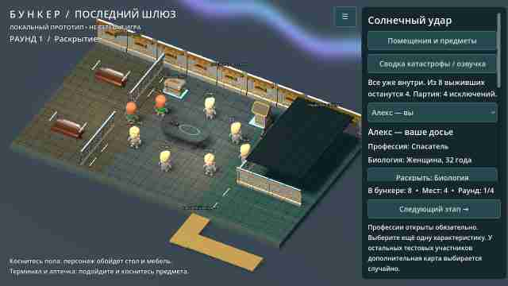

# Итерация 0.6 — графика, походка и последствия здоровья

## Архитектура и материалы

Вместо гладких полос-перегородок установлены секции панельных стен из CC0-набора Quaternius Modular Sci-Fi, с верхними световыми линиями. Добавлены металлические напольные модули с процедурными швами и зерном поверхности, стойки, вентиляционные решётки, трубопроводы, освещение спальни и общего зала. Стол переделан под командный стол с графитовой поверхностью и светящейся тактической схемой; заменены модели терминала и складского ящика. У коек добавлены металлические поручни и подсветка. Дверь медблока заменена моделью люка; закрытая крыша получила металлический материал.

Это всё ещё стилизованный мобильный cutaway-бункер с открытым для камеры потолком, не фотореалистичная AAA-сцена. Камера, проходимость, три варианта планировки и взаимодействия 0.5 сохранены. Декоративные детали закреплены на стенах, внутри уже учтённых габаритов мебели либо у поверхности пола, не создают скрытых препятствий.

## Другие фигурки и естественная противофаза

Подключён **KayKit Adventurers** автора Kay Lousberg: Knight, Rogue, Rogue Hooded. Это другие, текстурированные, стилизованные модели с лицами, волосами, одеждой и готовыми авторскими анимациями. Оружие, щиты, плащи и шлем скрываются при загрузке; полный неизменённый GLB и источник сохранены. Модели не являются фотореалистичными людьми, а имена исходного фэнтезийного набора не скрываются.

Для игровых участников используются авторские `Idle`, `Walking_C`, `Use_Item`; спокойная походка C выбрана вместо более преувеличенной A. Анимация обновляется вручную вместе с передвижением, руки и ноги одной стороны движутся в противофазе. Начальная поза Idle выставляется до первого кадра, чтобы в меню не было T-поз. Предпочтение внешности и смена модели по раскрытой биологии сохранены.

Для прежних Quaternius-фигур, оставшихся у заражённых снаружи, также исправлен знак взмаха рук. Тест измеряет отрицательную ковариацию продольного движения кисти и стопы одной стороны на обеих библиотеках, дополнительно проверяет плоскость шага, положение колена и геометрию стопы. У KayKit косточка `foot` расположена в пятке: при перекате проверяется также носок, а не запрещается естественный подъём пятки.

Лицензия нового набора — CC0-1.0, источник закреплён: `assets/licenses/KAYKIT_SOURCE.md`, `KAYKIT.txt`, SHA-256 — в `assets/manifest.json`. Платные ассеты, модели с неизвестными правами и записи Mixamo не добавлялись.

## Метеориты

Старые падающие простые частицы заменены шестью движущимися неровными каменными мешами. У каждого — огненный конический след с прозрачным затуханием, искры, траектория до поверхности, кратер и краткая ударная вспышка со светом. Камни летят снаружи убежища; визуальная проекция высокой траектории может пересекать силуэт здания, но точки удара расположены за его пределами. Крупный план в проверках фиксирует фазу полёта после прогрева шейдеров, а не случайно попавшую вспышку. Режим уменьшения движения скрывает летящие камни, останавливает частицы и убирает вспышки.

## 12 катастроф

Сохранены зима, наводнение, метеорный дождь и заражение. Добавлены:

1. **Радиоактивный след:** осадки/взвесь и загрязнённый внешний периметр.
2. **Химическое облако:** движущийся аэрозоль и зелёное аварийное освещение.
3. **Пепельное небо:** пепельная взвесь, раскалённые трещины и огненный отблеск.
4. **Песчаный фронт:** песчаная палитра и пылевые облака.
5. **Тепловой предел:** выжженная поверхность, пыль и дополнительный расход воды.
6. **Тёмный континент:** слабое наружное освещение, аварийная сеть и свет убежища.
7. **Разлом:** трещины грунта и пыль после толчков.
8. **Солнечный удар:** анимированное полярное сияние и нарушение связи по сюжету.

У каждого сценария есть собственная сводка, описание восстановления системы, наружного маршрута и исхода изгнания. Это 12 вариантов окружения и сюжетного контекста, а не 12 отдельных полноценных симуляторов катастроф. Для части сценариев используются общие системы пыли/тумана, но меняются палитра и дополнительные элементы.

## Отрицательные характеристики здоровья влияют на группу

Библиотека здоровья теперь содержит 14 структурированных состояний, из них 10 с дополнительным расходом ресурсов: инсулинозависимый диабет, астма, инфекция дыхательных путей, инфицированная рана, обезвоживание, выраженная пищевая непереносимость, восстановление после операции, тяжёлая аллергия, мигрени, лихорадка. У очков, сниженного слуха и некоторых других состояний нет автоматического ресурсного штрафа. Наличие болезни не определяет «ценность» участника и не задаёт результат голосования.

- В досье у видимой карточки здоровья отображается её **дополнительная нагрузка за раунд**.
- При переходе к новому раунду активные участники расходуют общую воду и рацион; состояния здоровья добавляют расход воды, еды, лекарств и фильтров. Изгнанные больше не учитываются. Жара дополнительно расходует воду, пыльные/токсичные катастрофы — фильтры.
- Начальные общие запасы: вода 100, рацион 100, лекарства 32, фильтры 24 условные единицы. Количества и стоимость — игровой баланс, не реальные медицинские нормы или схема лечения.
- Повторного списания за один раунд нет, значения не уходят ниже нуля.
- Каждый новый раунд расходует 12 бодрости; при дефиците — 20. Усталость плавно уменьшает скорость ходьбы, но не блокирует управление.
- При дефиците отдых восстанавливает 10 вместо 20 бодрости, осмотр — 5 вместо 15. Демонстрация не блокируется и не убивает персонажа автоматически.
- Запасы и отчёт о расходе доступны в «Помещения и предметы». Общие лекарства для регулярной поддержки и два одноразовых набора осмотра медблока — разные ресурсы, автоматически друг друга не заменяют.

Закрытые карточки здоровья не открываются автоматически. Заразность, заражение соседей и реальное лечение заболевания пока не симулируются; осмотр не стирает состояние здоровья из карточки. Параметры не меняют автоматически голоса или однократный d6.

## Проверки и ограничения

Исходники финального APK: `498d586`. [APK](https://github.com/AlfaGideon/Bunker/actions/runs/40622500528/artifacts/12787931996), [успешные проверки](https://github.com/AlfaGideon/Bunker/actions/runs/40622500486). ZIP: 61 170 539 байт.

Godot 4.5.1: импорт/компиляция, профиль, правила, навигация и движения, обе библиотеки ригов и противофаза, полный цикл исключений, регрессии 0.4 и 0.5. Генератор проверяется на 60 seed. Цепочка склада/терминала/медблока, сон, ограничения осмотра, радио и блокировка действий наблюдателя теперь прогоняются для всех 12 сценариев. Отдельно проверяются дополнительные расходы здоровья, списание только за активных участников, модификаторы катастрофы, отсутствие повторного списания и отрицательных остатков, последствия дефицита и новые меши метеоритов.

Рендеры — настоящие кадры Godot/Linux, уменьшенные и сжатые для передачи через Actions, не Android-скриншоты и не AI-иллюстрации. Крупный план фигур использует подготовленную расстановку; крупный план метеорита — фиксированную фазу полёта. Они не заменяют проверку игры на устройстве.

Физические касания, качество русского системного голоса, слышимость и FPS на BL9000 в этой среде не измерялись. Сетевая игра, чат, полноценные боты и сохранение текущей партии не добавлены. Отладочная подпись временная: при конфликте обновления может потребоваться удалить старую версию с потерей локального профиля.

## Реальные кадры

