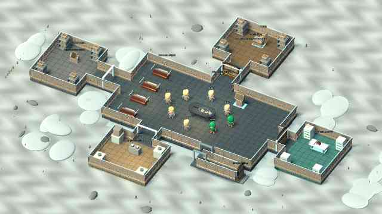
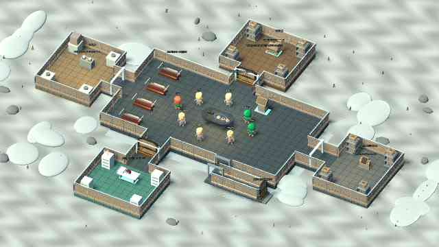
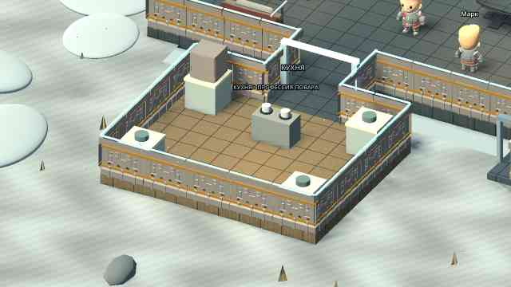
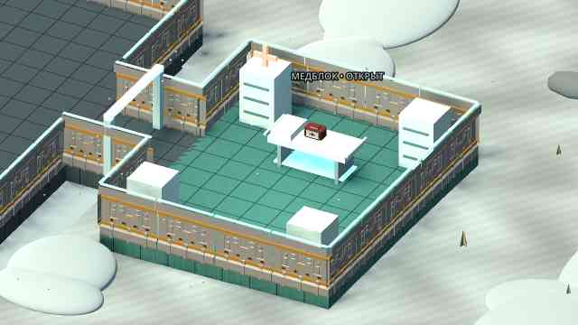

# 0.8 — бункер из отдельных наружных модулей

[**Скачать ZIP с APK**](https://github.com/AlfaGideon/Bunker/actions/runs/40628352360/artifacts/12790297844) · [Android build](https://github.com/AlfaGideon/Bunker/actions/runs/40628352360) · [Godot CI](https://github.com/AlfaGideon/Bunker/actions/runs/40628352318). Исходники `d75a034`, version code 8, ZIP 61 204 769 байт. Войти в GitHub, скачать ZIP и установить `bunker-debug.apk`.

Это исправление архитектуры 0.7, а не очередная перестановка мебели внутри прямоугольника.

## Что действительно изменено в коде

- Основной зал **18×10 м** содержит общий стол, спальные места и служебный терминал. В нём больше нет кухни, склада, медотсека и тренажёрного уголка.
- **Кухня, медотсек и склад — обязательные самостоятельные наружные комнаты**, каждая со своим полом-фундаментом, ограждением, освещением и оборудованием. Их размеры — 6,8×5,6 м либо 5,6×6,8 м в зависимости от стороны подключения.
- Генератор перемешивает северную, восточную, южную и западную стороны. Каждый обязательный тип комнаты может оказаться на любой из четырёх сторон. Между залом и комнатами — отдельные коридоры шириной 2,4 м и длиной 2–4 м.
- Дополнительно может появиться **спортзал, мастерская или теплица**, либо дополнительной комнаты не будет. Эта секция тоже отдельная пристройка, не предмет в основном зале.
- Внешняя форма здания меняется с seed: меняются назначение выступов, длина соединений и состав модулей. Между модулями действительно наружное пространство, а не сплошной скрытый пол.
- Помещения показаны в разрезе, без закрывающей их крыши. Это позволяет видеть персонажей, оборудование и проходы внутри объёмных модулей.

## Оснащение

- **Медотсек:** отдельная медицинская кушетка вместо ещё одной деревянной спальной кровати, аптечка, шкафы с ящиками, медицинский знак и собственный свет.
- **Кухня:** плита с посудой, несколько рабочих поверхностей, холодильник и посуда. Само приготовление доступно пищевым профессиям; общий стол с готовыми порциями остаётся в зале.
- **Склад:** отдельная дверь, стеллажи с несколькими уровнями, ящики снабжения и центральный контейнер. Решение совета по-прежнему может оставить его закрытым до конца партии.
- **Спортзал:** центральная скамья со штангой, дополнительные скамьи, стойки с весами и маты — не один тренажёр в общей комнате.
- **Мастерская / теплица:** отдельные оснащённые помещения со стеллажами либо несколькими посадочными секциями.

## Перемещение и камера

`bunker_layout.gd` выдаёт общий набор контуров полов, коридоров, дверей и мебели. `modular_shell.gd` строит по ним основание и наружные границы, оставляя реальные отверстия в местах соединений. `room_navigation.gd` использует те же контуры: пустоты между пристройками непроходимы, мебель обходится, закрытые медицинский и складской коридоры блокируются отдельно.

В «Помещениях и предметах» появились кнопки **«Осмотреть»** для отдельных пристроек. Это только перемещение камеры, не обход профессиональных прав. При назначении работы камера приближает нужную комнату. Кнопка **«Общий вид бункера»** слева возвращает обзор всего здания. Общий вид рассчитывается по реальному силуэту модулей, а не по старому размеру прямоугольной комнаты.

Трава, камни и сугробы не ставятся поверх новых комнат. Грунт расширен под обзор более крупного здания.

## Что проверяется

В существующий тест 60 seed добавлены проверки, что комнаты находятся **за пределами основного зала**, не пересекаются друг с другом, соединены с залом своими коридорами и все три обязательных назначения встречаются на всех четырёх сторонах. Проверяется изменение силуэта здания, воспроизводимость seed и реальные маршруты ко всем доступным объектам. Сохранены проверки профессий, готовки, совета склада, таймера, способностей, кубиков, ригов и голосования.

Для сравнения в workflow добавлены два настоящих рендера архитектуры без интерфейса — seed 0 и seed 17. Отдельно снимаются кухня и медотсек крупным планом.

## Ограничения

Это модульная генерация по четырём внешним направлениям, а не бесконечный генератор произвольного здания. Комнаты пока прямоугольные, стены показаны в разрезе. Сохраняются ограничения локального прототипа: нет сети, чата, автономных ботов, боя и сохранения партии. Проверки сборки и рендеры не заменяют тест касаний, FPS и звука на физическом BL9000.

## Подтверждённый результат

Android run `40628352360` успешен: все десять тестовых скриптов и экспорт APK. Godot run `40628352318` успешен: checks, visual-quality и visual-variants. Архитектурные снимки вынесены в отдельный job, чтобы не терять части JPEG из-за лимита аннотаций; [сравнение seed 0 и 17](https://github.com/AlfaGideon/Bunker/actions/runs/40628676625) также успешно отрендерено. В репозитории сохранены 16 полных проверенных JPEG `docs/previews/*-v0.8.jpg`. Это настоящие снимки Godot, не концепт-картинки.

## Реальные рендеры

