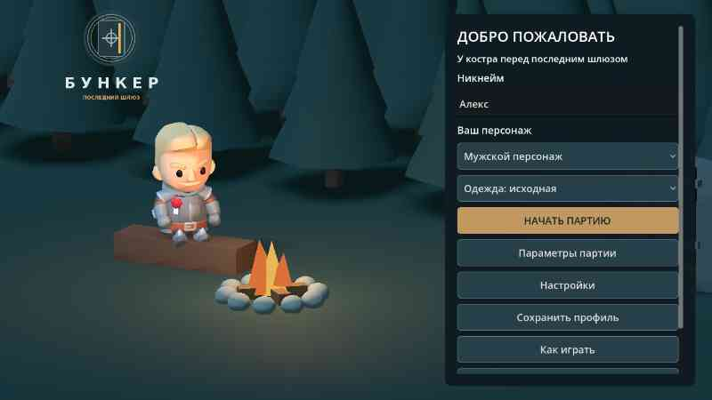

# 0.10 — отдельное приветственное меню у костра

[**Скачать ZIP с APK**](https://github.com/AlfaGideon/Bunker/actions/runs/40632081862/artifacts/12792335342) · [Android build](https://github.com/AlfaGideon/Bunker/actions/runs/40632081862) · [Godot CI](https://github.com/AlfaGideon/Bunker/actions/runs/40632081914).

Исходники APK: `d536e08`, version code 10, `0.10.0-welcome-camp`. ZIP 61 448 796 байт. Нужен вход в GitHub: скачать ZIP, распаковать и установить `bunker-debug.apk`. При конфликте debug-подписи потребуется удалить старую установку с потерей локального профиля.

## Теперь приложение действительно начинается с меню

Главная сцена проекта — **`game/welcome.tscn`**, а не бункер. До нажатия «Начать партию» не создаются бункер, раздача карточек, таймер выступлений и участники партии; счётчик миров не увеличивается. После нажатия загружается `game/main.tscn`, применяется сохранённый профиль, генерируется одна партия и открывается её аварийная сводка.

В меню паузы внутри бункера добавлен отдельный возврат к приветственному экрану с предупреждением, что текущая партия будет потеряна. Сохранения партии между перезапусками по-прежнему нет, поэтому приветственное меню не предлагает ложную кнопку «Продолжить».

## Живая сцена, не фоновая картинка

Перед камерой — небольшой ночной лагерь с хвойными деревьями, входом в убежище, бревном, каменным кольцом костра и тёплым локальным светом. Персонаж сидит на бревне: используется реальная авторская анимация **`Sit_Chair_Idle`** из лицензированного CC0-набора KayKit. Пламя меняет форму, свет слегка мерцает; анимация продолжается, пока пользователь настраивает профиль.

Модель меняется сразу при выборе мужского/женского персонажа. Дополнительно доступны исходный, песочный и холодный графитовый оттенки одежды; материал меняется только на торсе, а не на коже/лице. Выбор сохраняется и переносится в партию. Существующее правило сохраняется: открытая биология в партии определяет пол и возраст персонажа.

## Действия в приветственном меню

- Ввести никнейм (до 20 символов); пустое имя не принимается.
- Изменить модель и оттенок одежды, сразу видя результат у костра.
- Сохранить профиль или сразу начать партию — старт также сохраняет выбор.
- Выбрать 6/8/10 участников и одну из катастроф либо случайную.
- Настроить громкость, системную озвучку сводки и вторичные движения в партии.
- Прочитать краткие правила или выйти из приложения.

Правая панель прокручивается: кнопки не уменьшаются до неудобных размеров ради размещения всех пунктов на одном экране. Меню не является сетевым аккаунтом; профиль локальный.

## Рабочая айдентика и заставка

Стандартная загрузочная картинка Godot заменена собственным знаком шлюза и названием. Используются `assets/branding/splash.png`, прозрачный `logo.png` в меню и `icon.svg` для приложения. Их можно воспроизвести скриптом `tools/create_branding.py` (Pillow; растровые надписи DejaVu Sans).

Предложенные генератором варианты не были выбраны. Поэтому текущий геометрический знак — **рабочий, не утверждённый финальный логотип**; он хранится отдельно от сцены и может быть заменён без переделки меню. Неиспользованные варианты в проект не добавлены.

## Проверки и ограничения

В оба workflow добавлен `test_welcome.gd`. Проверяются начальная сцена, отсутствие генерации мира при запуске меню, настоящая сидячая анимация и её продвижение, моментальная замена модели, валидация и сохранение имени/одежды, доступность настроек, **реальный переход по «Начать» в партию**, перенос профиля и выгрузка лагеря. Сохранены остальные тесты правил, архитектуры и сенсорной камеры — всего 12 тестовых скриптов.

Меню и второй вариант внешности отрендерены настоящим Godot. Основной снимок заменяет `docs/previews/menu.jpg`; диагностический второй вариант не сохраняется как дополнительная историческая копия. В проекте остаётся один набор из 16 актуальных скриншотов с постоянными именами.

Физические загрузка, клавиатура, касания, звук и FPS на BL9000 ещё требуют проверки на устройстве. Сеть, чат, автономные боты и сохранение партии не добавлены.

Подтверждённый результат: Android run `40632081862` и Godot run `40632081914` успешны; в Godot прошли checks, visual-architecture, visual-quality и visual-variants. Все 16 текущих JPEG полностью декодированы.
