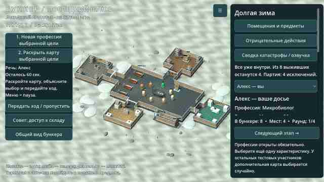

# 0.12 — камера, иконка и отрицательные действия

[**Скачать ZIP с APK**](https://github.com/AlfaGideon/Bunker/actions/runs/40684852932/artifacts/12815035009) · [Android build](https://github.com/AlfaGideon/Bunker/actions/runs/40684852932) · [Godot CI](https://github.com/AlfaGideon/Bunker/actions/runs/40684853007).

Исходники `6f539b3`, version code 12, `0.12.0-character-actions`; ZIP **64 271 689 байт**. Войти в GitHub, скачать ZIP и установить извлечённый `bunker-debug.apk`. При конфликте debug-подписей потребуется удалить прежнюю установку, с потерей локального профиля.

## Камера

Жесты сохранены: свайп перемещает камеру, щипок меняет масштаб. Размер ортокамеры ограничен диапазоном 7–40 вместо 4–80. При масштабировании дополнительно рассчитывается реальная проекция всех четырёх углов экрана на землю: на широком экране предельное отдаление при необходимости уменьшается. Панорамирование ограничено окрестностями бункера и безопасной областью земли `[-56, 56]` при размере площадки `[-64, 64]`. Поэтому ограничен не только центр камеры: весь видимый участок остаётся внутри земли с запасом до края. Начальное кадрирование также применяет ограничения. При отдалении камера дополнительно отодвигается вдоль оси взгляда: масштаб и привязка к земле не меняются, но нижние лучи экрана больше не оказываются под землёй и не создают полосу от ближней плоскости отсечения. Все четыре угла проверяются на существование пересечения с землёй.

Тесты проверяют минимальный и максимальный масштаб, сильные свайпы к разным краям, привязку зума к пальцам, обычное соотношение сторон и расширенный экран BL9000 2460×1080. Это проверка геометрии и ввода в движке, не испытание на физическом телефоне.

## Полный логотип на иконке

В 0.11 дверь была намеренно выделена из выбранного изображения для маленькой иконки. Это отдельное решение реализации, а не другая генерация. В 0.12 иконка производится из **всего выбранного знака, с надписью**, вписанного в квадрат без вырезания двери. Исходник пользователя не меняется; меню и загрузочная заставка сохраняются. Для Android adaptive icon отдельно подготовлены прозрачный передний слой с полным знаком в центральной безопасной зоне и тёмный фон: круглая маска лаунчера не должна срезать крайние буквы. Пути всех трёх вариантов явно указаны в export preset. Из-за малого размера иконки мелкая подпись неизбежно читается хуже, чем в меню.

## Отрицательные действия

В меню партии и на правой панели появилась кнопка «Отрицательные действия». Требования и последствия видны всем, но кнопки доступны только при соответствующем недостатке собственного персонажа:

| Характер | Действие | Реальное последствие для группы |
|---|---|---|
| Вспыльчивый | Устроить ссору | Разбита ёмкость: вода −3 |
| Эгоистичный | Испортить общий рацион, пряча еду | Рацион −4 |
| Небрежный / Упрямый | Пропустить обслуживание фильтра | Фильтры −1 |

Три новых отрицательных качества добавлены в случайную раздачу. Упрямство было в наборе раньше. Профессия, болезнь или инвалидность сами по себе такие действия **не открывают**. Положительные активности и их профессиональные ограничения сохранены.

Поступки добровольные, требуют подтверждения и раскрывают недостаток группе через обычное публичное досье. Не более одного отрицательного действия за раунд; при недостатке запасов списания нет. Исключённый персонаж, финал, голосование, движение или отдых блокируют действие. Проверка прав есть не только у кнопки, но и в методе исполнения. NPC не совершают случайный саботаж автоматически: это действие локального игрока, а не дополнительный скрытый штраф.

Отдельный тест проверяет условия доступа, прямой вызов API, реальную кнопку и подтверждение, списание общих запасов, раскрытие карты, повторное использование, нехватку ресурсов и исключение игрока. Диагностический рендер меню не добавляется к постоянным 16 скриншотам.

## Сотрудничество

[Текст обращения владельцу сайта](COOPERATION_PROPOSAL_RU.md). Это черновик для предварительного знакомства: честно указаны стадия прототипа и отсутствие сетевого режима. Ничего не отправлялось; передача прав, интеграция и коммерческие условия не обещаны и требуют отдельного обсуждения.

## Результат проверки

Android build и все четыре job Godot workflow успешны. Все 13 тестовых скриптов выполнены, включая настоящий UI подтверждения отрицательного действия. Проверено, что viewport теста действительно расширился до соотношения сторон BL9000, все четыре экранных луча пересекают землю и весь видимый прямоугольник остаётся внутри безопасных границ. Дополнительно проверена геометрия adaptive icon: ни один непрозрачный пиксель знака не выходит за круглый Android viewport.

Проверены настоящий рендер игрового вида без нижней полосы отсечения и меню отрицательных действий. Полный набор из 16 JPEG заменён под прежними именами и полностью декодирован; временные диагностические JPEG удалены. На физическом телефоне ещё нужно проверить управление, FPS, установку и вид иконки в конкретном лаунчере.

