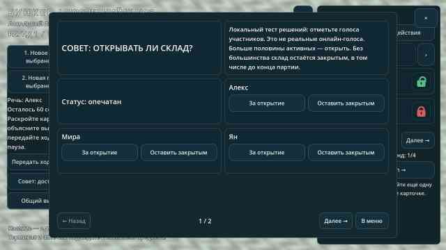
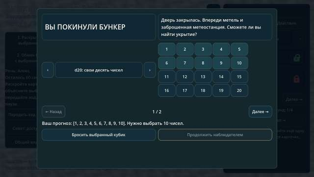

# 0.15 — карточки во всех меню и замки характеристик

[**Скачать APK**](https://github.com/AlfaGideon/Bunker/releases/download/android-15/Bunker-Posledniy-Shlyuz-15.apk) · [Release](https://github.com/AlfaGideon/Bunker/releases/tag/android-15) · [Подпись и совместимость](https://github.com/AlfaGideon/Bunker/actions/runs/40704103210) · [Godot CI](https://github.com/AlfaGideon/Bunker/actions/runs/40704103644)

Исходники `d5e8448`, version code 15, версия 0.15.0. APK 59 876 268 байт; SHA-256 `d5005bca735748de6bbdf16147c23832786c9217b7e435b29eb7ebbcd345f664`. Фирменный APK и legacy-копия идентичны.

## Меню без вертикальной прокрутки

Общий `card_deck.gd` заменяет ScrollContainer в меню партии, досье и экране выживания. Подразделы приветственного экрана используют тот же компонент: профиль, параметры партии, настройки и правила. Карточки распределяются по страницам; снизу всегда доступны «Назад / Далее», номер страницы и, в меню, выход на главный экран. У меню партии есть отдельная постоянная кнопка закрытия.

Страницы скрывают, но не уничтожают элементы формы: введённое имя, seed, настройки и выбранные числа кубика не теряются при перелистывании. Действия с отрицательным характером объединены с требованиями и последствиями в одну карточку; голоса каждого участника совета — с его именем. Длинные инструкции разбиваются на несколько читаемых карточек.

Выпадающие OptionButton заменены на `card_choice.gd`: значение между двумя сенсорными кнопками. Поэтому нет и нативных выпадающих списков с боковой прокруткой. Единственные оставшиеся HSlider — громкость; настройки яркости в прототипе пока нет. Для масштаба камеры используются ограниченные диапазоном кнопки «Ближе / Дальше», без перехода с крайнего масштаба на противоположный. Прямые жесты камеры в игре сохранены.

Общий стиль задаёт скруглённые карточки, состояния нажатия/фокуса и анимацию появления. Сохранённая настройка уменьшения эффектов отключает проявление. Главные семь карточек у костра и настоящая заставка с Running_A из 0.14 сохранены; новая партия из игрового меню тоже проходит через подготовку.

## Маленький замок вместо большой кнопки раскрытия

Каждая характеристика в досье имеет отдельный замок размером 52×52 логических пикселя. Он рисуется векторно, без зависимости от шрифта или emoji:

- красный закрытый — характеристика ещё не публична;
- зелёный открытый — характеристика открыта всем в публичном досье;
- профессия публична с начала партии;
- раскрыть собственную скрытую характеристику можно только в свой ход раскрытия и только одну за этот ход;
- замки чужих характеристик и недоступные действия не нажимаются.

`reveal_parameter()` меняет публичный флаг через существующий `_reveal_card()` и устанавливает `speech.revealed`. Метод не вызывает `speech.start()`, `pass_turn()` и не записывает `speech.remaining`: оставшееся время речи не сбрасывается и не увеличивается. Открытая биология по-прежнему меняет внешность по игровым полу и возрасту. После раскрытия сохраняется страница досье, чтобы зелёный замок не исчезал из текущего просмотра.

**Это локальный прототип.** Публичность означает видимость в общей модели досье; сетевой синхронизации между телефонами пока нет.

## Проверки и совместимость

Новый `tools/test_card_menus.gd` проверяет страницы игровых меню, доступность навигации и нижней части HUD, отсутствие ScrollContainer/OptionButton, настоящий клик красного замка, публичное значение для другого наблюдателя, зелёное состояние, неизменность 37,25 секунды и последующее уменьшение до 36 секунд, запрет второго раскрытия и выбор d20 независимо от видимости страницы.

Тест приветствия проходит по всем страницам каждого подраздела и проверяет доступность нижней навигации. Тест отрицательных действий ищет настоящие вложенные кнопки карточек и сохраняет проверку подтверждения и списания ресурсов. Дополнительные CI-рендеры показывают профиль и настройки; постоянный набор остаётся одним набором из 16 JPEG без архивов старых изображений.

Package ID, постоянный ключ подписи и формат профиля не меняются. Для обновления старой версии сохраняется legacy-копия `bunker-15.apk` вместе с `Bunker-Posledniy-Shlyuz-15.apk`. Реальная установка поверх предыдущей версии и сенсорное тестирование на Blackview BL9000 требуют проверки на устройстве.

## Результат

Публичный Release android-15 опубликован из `d5e8448`. Все 15 GDScript-тестов, Python-проверка версии, четыре job Godot, Android export и подписанный Release успешны. Release job сравнил сертификат с опубликованной 0.14 и подтвердил совпадение. API latest возвращает 15 с обоими APK. Настоящие рендеры досье с красным и зелёным замками, профиля, настроек, совета и d20 просмотрены. Все 16 текущих JPEG обновлены под прежними именами и полностью декодированы; диагностические JPEG удалены.

