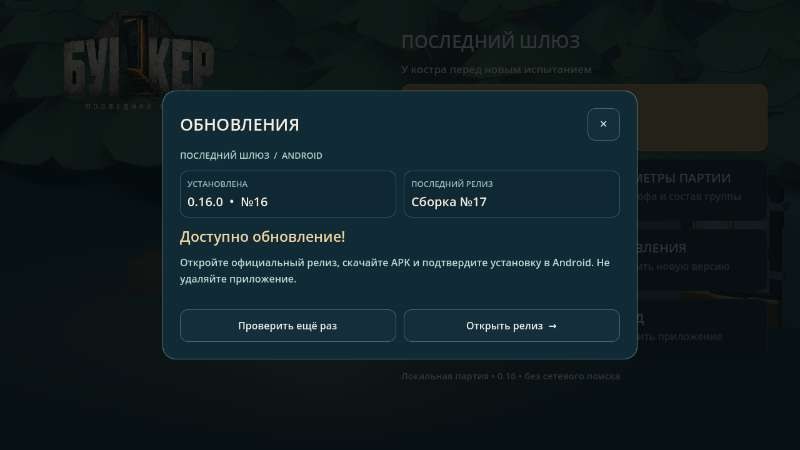

# 0.16 — экран обновлений

В 0.15 запрос к GitHub API мог получить HTTP 403, в том числе из-за ограничений анонимных запросов с общего IP. Точная причина конкретного ответа на телефоне не установлена. Основная проверка теперь использует публичный `releases/latest` на github.com, без GitHub API; при неудаче пробует API. Обрабатываются только канонические перенаправления на числовой Android-тег этого репозитория; переход к загрузке — через официальный релиз и подтверждение пользователем в Android. При отсутствии связи показывается состояние ошибки и повторная проверка, а не утверждение об актуальности.

Экран обновлений заменён затемнённым фоном и карточкой в стиле игры: установленная сборка, последний релиз, состояние, горизонтальные сенсорные кнопки и плавное появление с учётом настройки уменьшения движения. Установка остаётся ручной.

Автоматически проверены текущая, новая и более старая сборки, отказ от чужих и повреждённых адресов, размеры кнопок, закрытие экрана и реальные обращения к публичному GitHub. Отдельная проверка на физическом BL9000 ещё необходима.

## Опубликовано

[APK 0.16](https://github.com/AlfaGideon/Bunker/releases/download/android-16/Bunker-Posledniy-Shlyuz-16.apk) · [Release](https://github.com/AlfaGideon/Bunker/releases/tag/android-16) · [Godot CI](https://github.com/AlfaGideon/Bunker/actions/runs/40723127552) · [подписанная сборка](https://github.com/AlfaGideon/Bunker/actions/runs/40723127578). APK: 59 884 629 байт, SHA-256 `c7c8e3298d90b0a73302f9dc0f492b4dcd0e3b0ffb68e27d4d2beff2e508fdd3`. Подпись совпала с Android 15, идентификатор пакета прежний. Godot, Android и подписанная публикация успешны. Номер 17 на изображении — тестовый пример, не объявление о выпуске.

