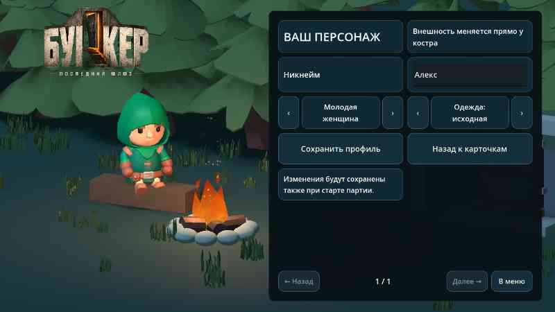
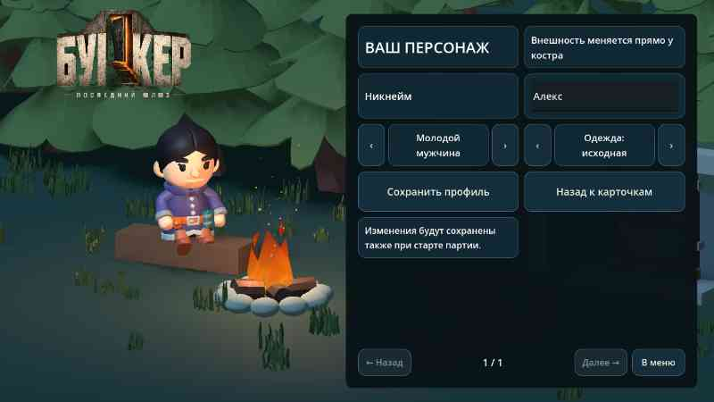
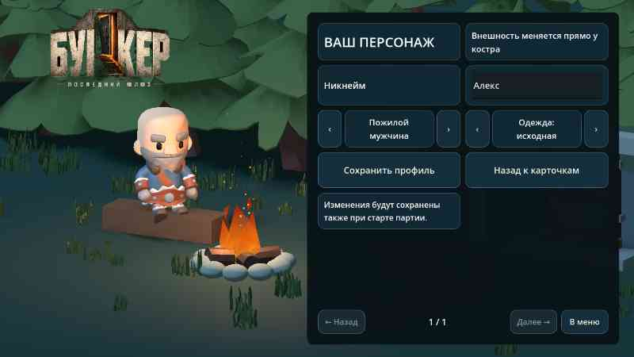

# 0.19 — выбор персонажа

В профиле у костра и настройках партии доступны шесть вариантов внешности: два прежних классических и четыре дополнительных — молодой мужчина, молодая женщина, пожилой мужчина и пожилая женщина. Стрелки сразу меняют фигурку у костра; профиль сохраняет выбор, он переносится в загрузочную кат-сцену и партию.

Мужские варианты — отдельные анимированные KayKit Mage и Barbarian; молодая женщина — доступный ранее в ресурсах Rogue_Hooded, теперь выбираемый в профиле; пожилая — адаптация Rogue с седыми волосами. Все модели и адаптация CC0, происхождение и хеши в `assets/manifest.json`. Классические модели не заменены.

При раскрытии биологии пол и возраст из карточки по-прежнему определяют внешний вид: 60+ лет отображаются пожилой фигуркой; до этого сохраняется выбранный косметический скин. Если биология уже раскрыта, смена настройки не подменяет биологию. Это локальная демонстрация, без синхронизации игроков по сети.

Проверены сохранение каждого варианта, выбор в интерфейсе, импорт и анимации сидения/вставания/бега, ходьба и противоположная фаза рук и ног, биология, реальные рендеры всех четырёх вариантов. Физическая установка и производительность на BL9000 требуют отдельной проверки.

## Публикация

[APK 0.19](https://github.com/AlfaGideon/Bunker/releases/download/android-19/Bunker-Posledniy-Shlyuz-19.apk) · [Release](https://github.com/AlfaGideon/Bunker/releases/tag/android-19) · [Godot CI](https://github.com/AlfaGideon/Bunker/actions/runs/40737028217) · [подписанная сборка](https://github.com/AlfaGideon/Bunker/actions/runs/40737028163). Исходники `0fa6615`, version code 19, 62 511 832 байта, SHA-256 `8af63d85560cb5260d6ac2a7f52284d038b3454d1467493efebb19725137ee3b`. Сертификат совпал с 0.18, пакет не изменился. Все шесть Godot jobs, Android и signed release успешны.

