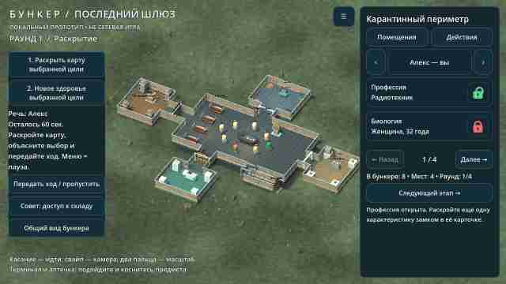
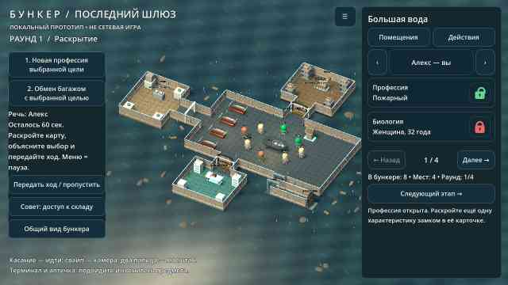

# 0.21 — заражённые и поверхности катастроф

В сценарии «Карантинный периметр» восемь заражённых патрулируют внешнюю границу процедурной планировки. Используются существующие CC0-модели с тонированными материалами и сутулой анимированной походкой; это декоративная угроза, атаки и заражение игрока не реализованы. Патруль не пересекает помещения или коридоры. Для режима уменьшенной анимации движение и частицы останавливаются.

Для земли добавлен процедурный шейдер с разномасштабной фактурой и расцветкой под условия. При наводнении отдельный шейдер добавляет волны и блики, учитывая уменьшенную анимацию. Вместо примитивных треугольников в окружении используется инстансированная модель травы. Это улучшение стилизованного прототипа, а не полная фотореалистичная переработка всех катастроф; эффекты работают в существующем мобильном GL Compatibility.

Проверены патрули на разных планировках, движение, отсутствие заражённых при наводнении, настройки уменьшенной анимации, запуск сценариев и рендеры в Godot CI. Производительность и качество на физическом BL9000 остаются непроверенными.

