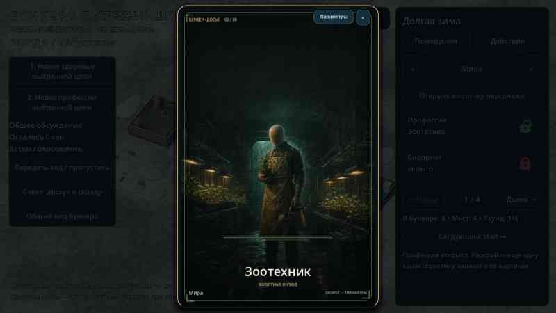
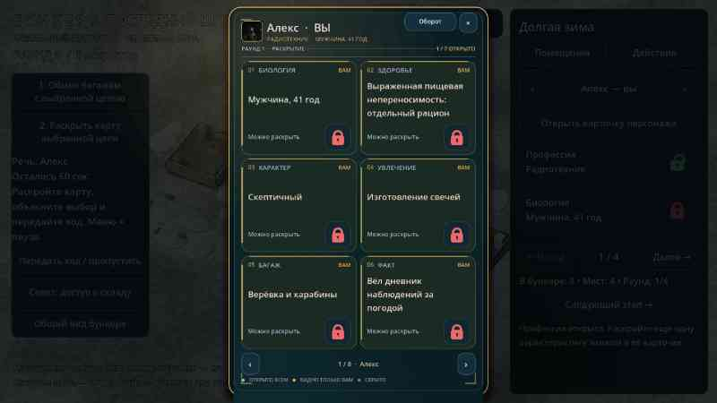
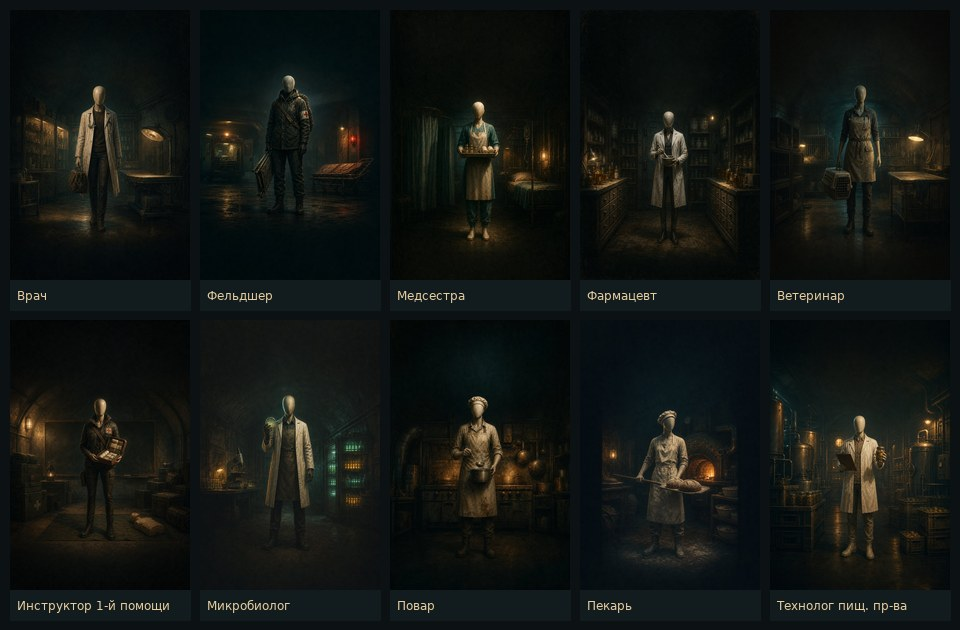
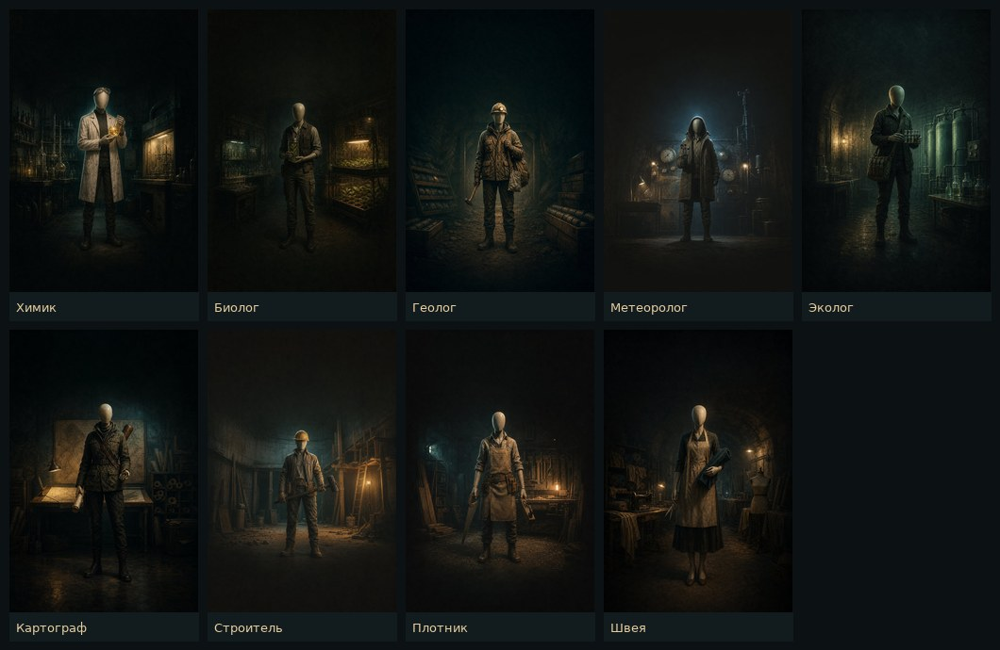
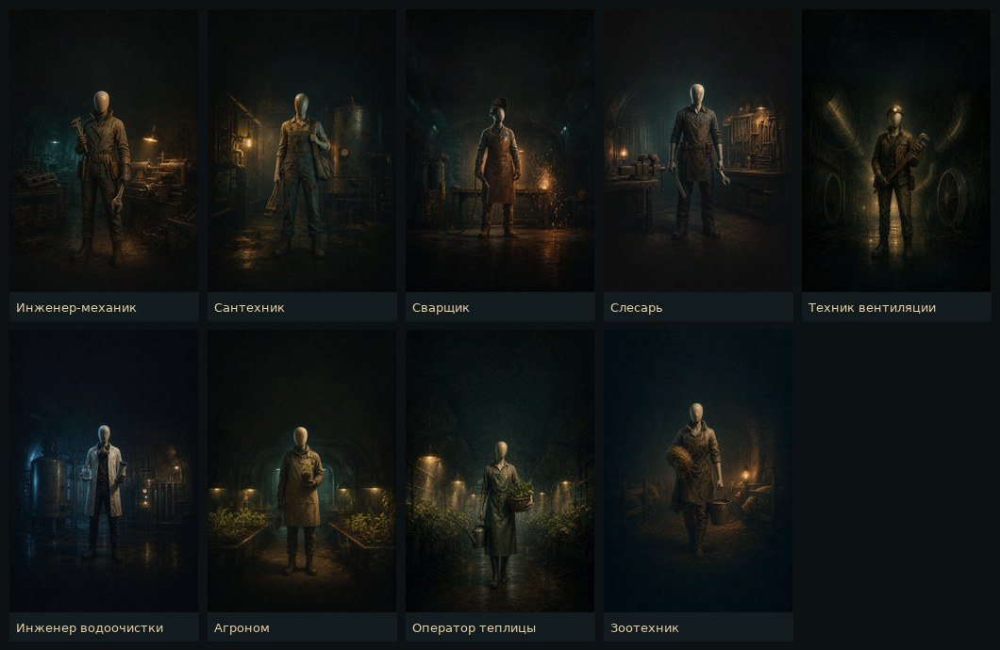
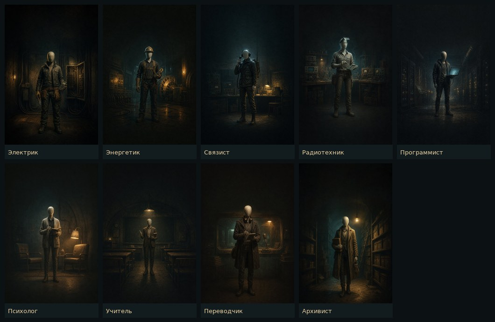
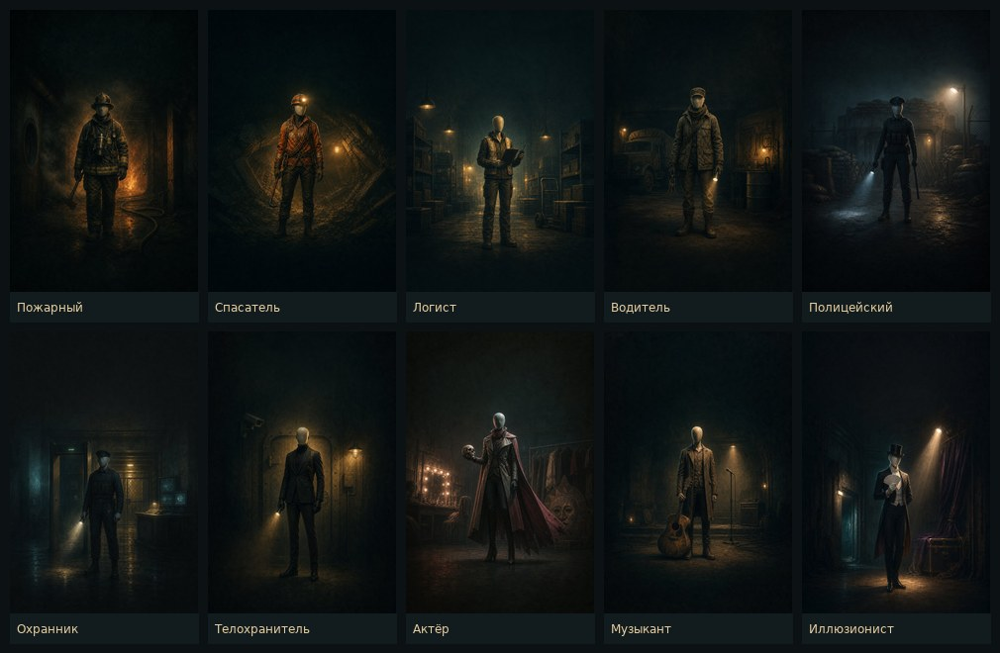
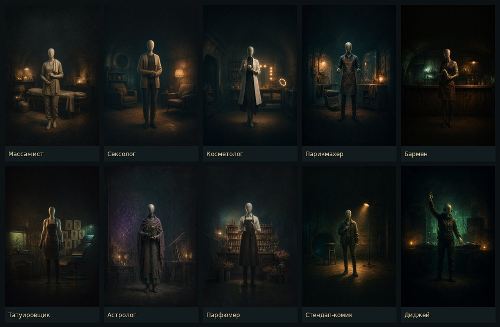
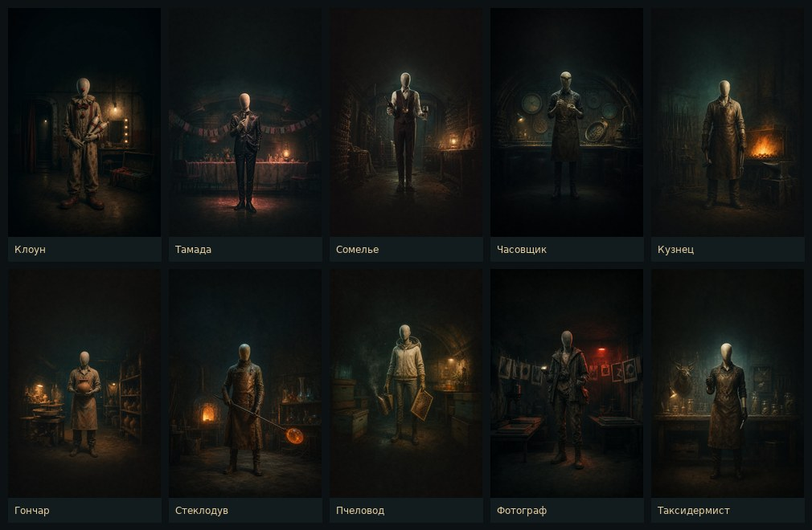
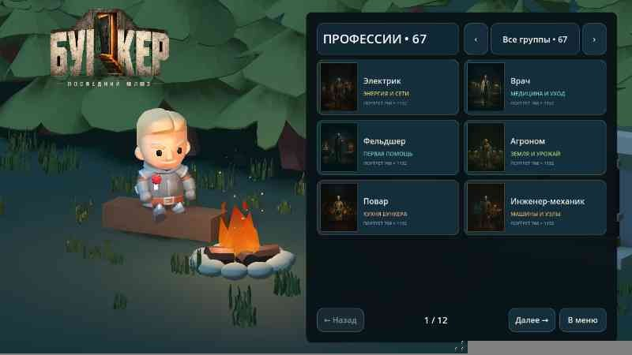

# 0.26 — карточки персонажей и библиотека профессий

Досье персонажа в партии теперь открывается как вертикальная коллекционная игральная карта (520 × 780, пропорция 2:3). Достаточно коснуться выжившего в комнате, его имени в боковом списке или кнопки «Открыть карточку персонажа» — поверх бункера появляется одна карта, без перелистывания и прокрутки.

**Сборка 0.26:** [APK](https://github.com/AlfaGideon/Bunker/releases/download/android-26/Bunker-Posledniy-Shlyuz-26.apk) · [Release android-26](https://github.com/AlfaGideon/Bunker/releases/tag/android-26) · version code 26, package `org.bunker.prototype`,
104 014 185 байт, подпись та же, что у 0.25. Godot CI — [запуск 41112242191](https://github.com/AlfaGideon/Bunker/actions/runs/41112242191),
debug APK — [41112242225](https://github.com/AlfaGideon/Bunker/actions/runs/41112242225),
подписанный релиз — [41112242490](https://github.com/AlfaGideon/Bunker/actions/runs/41112242490).

## Лицевая сторона

- Имя, профессия и состояние (пол и возраст показываются только после раскрытия «Биологии»).
- Шесть параметров одной сеткой 2 × 3: биология, здоровье, характер, увлечение, багаж и дополнительный факт. Профессия всегда открыта и вынесена в шапку карты.
- У каждой плитки свой номер, пиктограмма параметра, подпись и состояние: **открыто всем**, **видно только вам** или **скрыто**.
- Закрытые чужие значения не показываются даже частично: плитка заштрихована, вместо текста — маска, в углу замок.
- На своей закрытой плите есть красный замок: им можно раскрыть характеристику прямо из карточки, не возвращаясь в боковую панель.
- Здоровье дополнительно показывает нагрузку на общие запасы, когда значение открыто.
- В подвале — легенда состояний и стрелки перехода по всем участникам партии. Текущий игрок в боковом списке синхронизируется с картой.

## Оборотная сторона

Оборот — сгенерированная портретная иллюстрация: обезличенный манекен без лица в снаряжении профессии, в тёмном отсеке бункера. Верх и низ кадра затемнены, поэтому название профессии и девиз всегда читаются поверх изображения. Для каждой профессии готовится собственный портрет; если файл ещё не нарисован, используется портрет группы (медицина, наука, механика, энергия и связь, мастерская, пища, природа, спасение, знания, снабжение, охрана, сцена, уход за телом, ночная жизнь, ремесло, праздник и кадр — всего шестнадцать). Смена профессии меняет и картину, и палитру рамки. Файлы лежат в `assets/professions/`, это обычные JPEG, а не SVG.

Сейчас индивидуальные портреты есть у всех 67 профессий. Кроме исходных 41 добавлены двадцать шесть новых. В группах «Порядок и защита» и «Сцена и голос» — полицейский, охранник, телохранитель, актёр, музыкант и иллюзионист. Затем пришли нестандартные: массажист, сексолог, косметолог и парикмахер в группе «Тело и забота», а также бармен, татуировщик, астролог, парфюмер, стендап-комик и диджей в группе «Ночь и впечатления». Последняя партия — редкие ремёсла и праздник: часовщик, кузнец, гончар, стеклодув и таксидермист в группе «Ремесло и редкость», а клоун, тамада и фотограф в группе «Праздник и кадр»; сомелье пополнил пищу, пчеловод — природу. Для новых групп тоже есть запасные групповые иллюстрации.

Кнопка «Оборот» переворачивает карту с анимацией по оси X; на обороте та же кнопка называется «Параметры» и возвращает лицо; касание самой оборотной стороны тоже переворачивает карту. При включённом в профиле уменьшении движения переворот происходит мгновенно. В шапке лица — квадратный камео того же манекена.

## Библиотека: два раздела

Библиотека в главном меню больше не один длинный редактор. Она открывается страницей с двумя блоками и полосой живых портретов: **профессии** и **параметры**. Из любого раздела есть возврат в библиотеку, из библиотеки — в меню.

**Профессии.** Каталог показывает все 67 профессий с их индивидуальными иллюстрациями: миниатюра 768 × 1152, название и девиз группы. Сверху — фильтр по шестнадцати группам («Все группы», «Медицина», «Ремесло», «Праздник» и так далее) с числом профессий в каждой, свои профессии из библиотеки попадают в отдельный пункт «Свои профессии». Касание плитки открывает крупный портрет: картинка в пропорции игральной карты 2:3, название, девиз, группа и пояснение, что это оборотная сторона карточки в партии. Каталог листается теми же карточными страницами, что и остальные экраны, без прокрутки.

**Параметры.** Второй блок — прежний редактор: возраст, здоровье и болезни, характер, профессия, увлечение, багаж и дополнительный факт. Свои значения добавляются к стандартным, у болезни задаётся расход общих запасов, всё сохраняется на устройстве.

## Поведение и доступность

- Карточка модальная: пока она открыта, камера, ходьба и таймеры партии приостановлены.
- Закрытие: кнопка «×», касание затемнения или кнопка «Назад» на Android.
- Клавиатура на ПК: `Esc` — закрыть, `←`/`→` — другой участник, `Space`/`F` — переворот.
- Размер карты автоматически уменьшается под узкий экран, но вся сетка параметров остаётся на одной странице.
- Карта обновляется при каждом изменении состояния партии: раскрытие, смена раунда, голосование и итог сразу отражаются на плите и в счётчике «открыто».

## Файлы

- `game/scripts/character_card.gd` — модальная карта, лицевая и оборотная стороны, синхронизация с партией.
- `game/scripts/character_card_tile.gd` — плитка параметра с состояниями и замком раскрытия.
- `assets/professions/*.jpg` — сгенерированные портреты манекенов (768 × 1152): 67 индивидуальных и 16 групповых запасных.
- `game/scripts/profession_art.gd` — карта индивидуальных портретов, группы профессий, палитры, пиктограммы и загрузка иллюстраций с запасным групповым вариантом.
- `game/scripts/profession_art_view.gd` — оборотная иллюстрация, затемнение под текст и камео в шапке.
- `game/scripts/card_backdrop.gd` — фон лицевой стороны.
- `game/scripts/main.gd` — открытие карты касанием персонажа и из бокового списка.
- `game/scripts/card_choice.gd` — касание имени в боковом списке.
- `game/scripts/profession_gallery_card.gd` — плитка профессии в каталоге библиотеки: миниатюра, название, девиз.
- `game/scripts/library_editor.gd` — два раздела библиотеки: каталог портретов с фильтром групп и редактор параметров.
- `tools/test_library_gallery.gd` — проверка каталога, миниатюр и навигации.

## Проверки

`tools/test_character_card.gd` проверяет: карта вертикальная и появляется по касанию, помещается в экран целиком без прокрутки, все шесть плиток видны, для каждой из 67 профессий есть индивидуальная портретная иллюстрация, закрытые чужие параметры замаскированы, свои видны владельцу, раскрытие сразу обновляет карту, итог партии открывает всё, переворот работает, стрелки синхронизированы с боковым списком, а касание в 3D находит персонажа. Отдельный тест `tools/test_library_gallery.gd` проверяет два раздела библиотеки: полосу портретов на главной странице, каталог из всех 67 профессий, наличие файла картинки у каждой плитки, фильтр по шестнадцати группам, отсутствие прокрутки и выход из каталога обратно в библиотеку. Скриншоты лицевой и оборотной стороны рендерятся в CI (`--card-front`, `--card-back`, `--card-own`).
