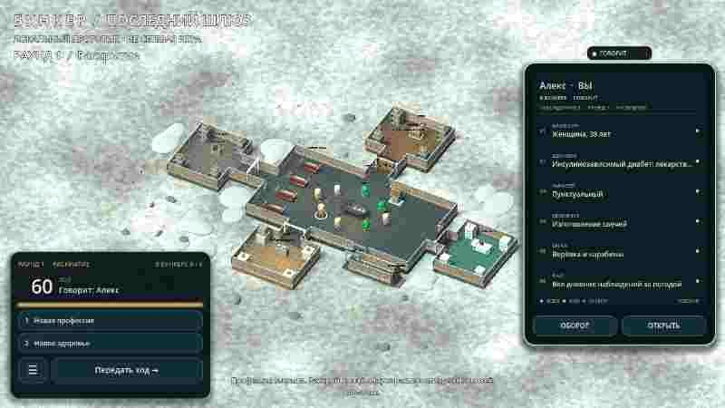

# 0.27 — карточка на столе вместо бокового меню

Боковая панель в партии убрана полностью: списка участников, кнопок «Помещения» и «Действия», пейджера параметров и текстового блока справа больше нет. Вместо неё на столе лежит одна игральная карта, а в левом нижнем углу — компактная панель хода.

Обратная сторона переворачивается к параметрам касанием:

## Карточка справа

- Вертикальная карта 340 × 500 в пропорции 2:3 у правого края экрана. Ничего не прокручивается и не перелистывается.
- Касание любого выжившего в комнате просто переключает карту на него — никаких окон и списков.
- По умолчанию карта лежит оборотом вверх: портрет профессии, название, девиз группы, имя и номер «03 / 08».
- Касание самой карты (или кнопки «Оборот») переворачивает её на месте: шесть параметров одной колонкой — биология, здоровье, характер, увлечение, багаж, факт. Открытые всем значения светлые, свои закрытые — тёплые, чужие закрытые остаются маской «••••».
- Карта того, кто говорит сейчас, светится: пульсирующая рамка цвета группы, значок «● ГОВОРИТ» над картой и подпись в шапке. Когда ход переходит дальше, карта сама переворачивается к портрету нового говорящего.
- В комнате говорящего дополнительно подсвечивает золотое кольцо на полу и его имя над головой.
- Кнопка «Открыть» разворачивает ту же карту в полное досье 520 × 780 — там остаются замки раскрытия параметров и стрелки по всем участникам.

## Панель хода слева снизу

Три чёрточки переехали из правого верхнего угла в левый нижний и стали частью панели хода:

- строка «РАУНД 2 · РАСКРЫТИЕ» и счётчик «В БУНКЕРЕ 5 / 8»;
- крупный таймер речи с полосой прогресса (цвет полосы меняется на обсуждении и голосовании);
- кто говорит прямо сейчас;
- две способности одним касанием;
- одна кнопка действия, которая меняется по фазе: «Передать ход →», «К голосованию →», «Идёт голосование», «Следующий раунд →»;
- квадратная кнопка «☰» — единственный оставшийся вход в меню партии.

Сообщения партии переехали в тонкую строку по центру снизу, чтобы не занимать карту и панель.

## Что осталось в меню

Меню по «☰» не потеряло функции: продолжить и новая партия, переролл, помещения и предметы, отрицательные действия, сводка катастрофы, профиль, настройки, обновления, правила, последнее сообщение, выход. Туда же добавлены «Общий вид бункера» и «Совет: доступ к складу», которые раньше жили на левой панели.

## Проверки

`tools/test_table_card.gd` проверяет: карта на столе вместо меню, вертикальную пропорцию, что она помещается в экран и стоит справа, что старый список участников исчез, что карта следует за говорящим и светится, что касание другого выжившего только переключает карту, что переворот показывает шесть параметров без прокрутки и чужие значения остаются скрытыми, что «Открыть» разворачивает полное досье, что панель хода и кнопка «☰» стоят в левом нижнем углу, что меню по ней открывается, а сообщение партии не уезжает за экран. Прежние тесты карточки, меню и HUD обновлены под новую раскладку.

## Сборка

`version/code` 27, версия 0.27.0, package `org.bunker.prototype`; подпись та же, что у 0.26, поэтому APK ставится поверх без удаления профиля.

[Скачать APK 0.27](https://github.com/AlfaGideon/Bunker/releases/download/android-27/Bunker-Posledniy-Shlyuz-27.apk) · [Release](https://github.com/AlfaGideon/Bunker/releases/tag/android-27) · APK 104 039 091 байт.
